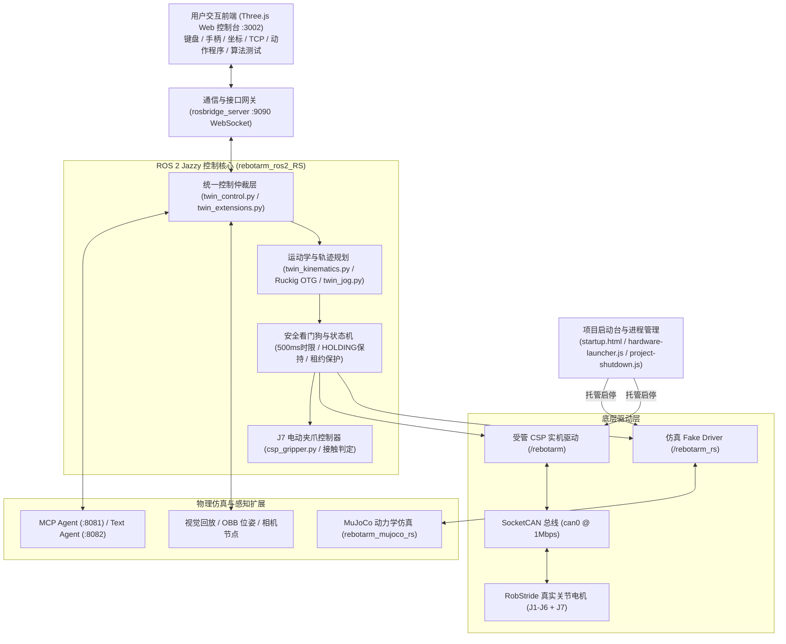
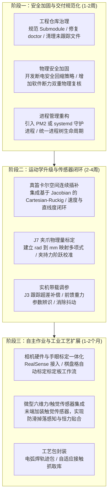

> 历史原稿，含未核实或已纠正的结论，不作为操作指令。当前评审版见上一级同名架构索引文档。

# B601-RS 工作空间架构体系、全文档功能索引与系统改进建议指南

> **文档定位**：本文档旨在全面梳理 `ReBot_Arm_DigitalTwin_RS` 工程的系统架构、数据链路、运行体系与各文档职责，并针对当前系统的安全隐患、技术瓶颈及功能缺失提出深度诊断与具体的工程改进建议，供后续系统重构、实机调试与功能扩展时查阅定位。

---

## 第一部分：工作空间核心定位与系统全景架构

### 1.1 项目背景与对象
本工程是专为 **睿尔曼 ReBot Arm B601-RS 六轴机械臂** 配套 **J7 电动夹爪**（合计 7 轴）打造的**高保真数字孪生、多模式交互控制与物理仿真系统**。系统运行环境推荐为 Ubuntu 24.04、ROS 2 Jazzy、Python 3.12 与 Node.js 18+。

### 1.2 核心系统组成
整个工作空间由四个核心子系统构成：

1. **统一 Web 数字孪生工作台 (`reBotArm_simulator-RS`)**
   - **双模型实时对照**：在浏览器中基于 Three.js 实时渲染“实线测量反馈模型”（编码器真实数据）与“半透明目标影子模型”（期望轨迹），直观呈现控制跟踪误差。
   - **多输入融合**：同一套底层链路支持绝对坐标到点、键盘微动、标准游戏手柄（按住 RB 安全使能）、TCP 空间拖拽（支持姿态锁定）和 J7 夹爪开合。
   - **向导式启动与退出**：提供 `startup.html` 步骤式启动台，引导检查 ROS、启用 CAN、启动只读反馈；配套带状态互锁的 `project-shutdown.js` 安全退出服务。
   - **任务编排与算法监视**：支持版本化 JSON 动作程序（示教、预览、直接执行、暂停继续）以及外部控制算法（PID、LADRC、MPC 等）的闭环试跑与监视。

2. **ROS 2 核心控制系统 (`rebotarm_ros2_RS`)**
   - **Fake 驱动 (`fake_rs_driver.py`)**：在 `/rebotarm_rs` 命名空间下提供不依赖硬件的仿真驱动。
   - **受管 CSP 实机驱动 (`csp_twin_driver.py`, `csp_hardware.py`)**：独占 SocketCAN 线程，锁定 RobStride CSP SDK（commit `6415d431`）。坚持“默认只读、显式租约使能”，杜绝未授权移动。
   - **平滑轨迹与安全仲裁**：集成 Ruckig 三阶 Jerk 约束轨迹生成器；内置 500 ms 看门狗、通信失联自动保持（HOLDING）、自碰撞与名义重力校验、越界拦截及故障锁定保护。
   - **J7 专用控制**：独立的 J7 电动夹爪状态机，支持行程、速度与电机接触相电流综合判定的 `grasp` 条件步骤。

3. **MuJoCo 高精度物理仿真**
   - `rebotarm_mujoco_rs` 与 ROS 2 进行双向状态同步，提供虚拟俯视相机、腕部相机及颜色检测抓取演示；另有基于 WebAssembly 的轻量级网页仿真演示 `web_mujoco`。

4. **运维与自动化工具链**
   - `./rebotarm` 统一 CLI 工具、Linux 桌面启动器、CAN 配置脚本与离线自动化回归测试套件。

---

## 第二部分：工程全文档功能索引与职责目录

为了便于后续精准定位与分工改进，现将工作空间内全部文档按功能维度划分为 7 大类别：

### 2.1 根目录核心总览与用户/开发者指南

| 文档名称 | 路径 | 核心功能与职责说明 |
| :--- | :--- | :--- |
| **README.md** | `README.md` | **项目总纲**。介绍工程定位、系统入口（3002端口）、默认控制参数边界、安装迁移要求、实机验收状态与核心文档导航。 |
| **快速启动指南.md** | `快速启动指南.md` | **日常操作手册**。专为一线人员编写的“傻瓜式”指南，包含桌面图标启动、按步检查连接、手动/程序控制、安全支撑与退出流程。 |
| **USER_MANUAL_ZH.md** | `USER_MANUAL_ZH.md` | **完整用户手册**。系统介绍工作台组成、系统依赖、MuJoCo 物理仿真、网页控制、视觉抓放演示、真机安全规则与常见操作排障。 |
| **DEVELOPER_GUIDE_ZH.md** | `DEVELOPER_GUIDE_ZH.md` | **完整开发者手册**。深入讲解源码架构、ROS 2 各节点通信拓扑、编译构建步骤、二次开发扩展规范与软硬件安全红线。 |
| **DATA_FLOW_RS_ZH.md** | `DATA_FLOW_RS_ZH.md` | **数据流与链路处理手册**。使用详尽流程图拆解从前端拖拽、rosbridge、ROS 话题、125 Hz 轨迹平滑，直至底层 SocketCAN/RobStride 电机执行的时序链。 |
| **DM_RS_COMPARISON_ZH.md** | `DM_RS_COMPARISON_ZH.md` | **DM 与 RS 架构对比手册**。对比达妙（串口/POS_VEL/500Hz）与睿尔曼（SocketCAN/CSP/MIT/125Hz）在总线、模式、反馈滤波及安全状态机上的差异。 |
| **LEADER_TELEOP_ROS_PLAN_ZH.md** | `LEADER_TELEOP_ROS_PLAN_ZH.md` | **主从遥操作方案设计**。记录将 Arm102 主手通过串口 SDK 接入 ROS 2 控制从臂跟随的架构规划、会话管理与安全映射策略。 |
| **LEADER_TELEOP_TEST_ZH.md** | `LEADER_TELEOP_TEST_ZH.md` | **主从遥操作实测记录**。记录主手端口扫描、串口权限配置、标定零点、角度映射及现场跟随联调的测试记录。 |

---

### 2.2 交付总纲与系统运维文档（`docs/` 目录）

| 文档名称 | 路径 | 核心功能与职责说明 |
| :--- | :--- | :--- |
| **项目交付文档_2026-10-17.md** | `docs/项目交付文档_2026-10-17.md` | **正式交付技术总纲**（对应 `docs/交付/` 下 docx/pdf）。规定交付范围、软硬件部署与迁移步骤、动作程序数据合同、备份机制以及未通过项与实机验收边界。 |
| **详细启动与排障_2026-10-17.md** | `docs/详细启动与排障_2026-10-17.md` | **系统排障全书**。详述依赖安装、嵌套 Git 依赖处理、CAN 总线权限配置、网络/端口故障、通信只读恢复等底层排障方案。 |
| **文件说明.md** | `docs/文件说明.md` | **代码资产职责说明书**。对 ROS 2 源码、网页前端脚本、测试套件、构建生成物及上层分支资产按文件/文件组逐一说明职责划分。 |
| **系统入口整理_2026-10-18.md** | `docs/系统入口整理_2026-10-18.md` | **操作入口规范**。规范项目启动台、工作台左侧导航栏、各项控制子面板的职责边界，避免多控制链路混用。 |
| **左侧工具栏与项目启动台_2026-10-17.md** | `docs/左侧工具栏与项目启动台_2026-10-17.md` | **界面布局演进记录**。记录统一整合左侧抽屉工具栏、将零散控制面板模块化集成到启动台与操作台的设计演进。 |
| **一页操作总台_2026-10-17.md** | `docs/一页操作总台_2026-10-17.md` | **一体化控制台设计说明**。记录实现单页面整合 3D 显示、反馈对照、遥操作、程序管理与调参的实现细节。 |
| **项目一键退出_2026-10-18.md** | `docs/项目一键退出_2026-10-18.md` | **安全关停逻辑规范**。阐明后端一键终止服务的实现逻辑，强制执行“先机械支撑、再电机撤力、后终止后台进程”的安全时序。 |
| **重启排障_2026-10-18.md** | `docs/重启排障_2026-10-18.md` | **服务恢复指南**。针对后台守护进程残留、CAN 租约未释放、端口被占用等情况的定位与恢复指引。 |

---

### 2.3 控制体系、运动学与控制算法文档（`docs/` 目录）

| 文档名称 | 路径 | 核心功能与职责说明 |
| :--- | :--- | :--- |
| **完整控制操作说明.md** | `docs/完整控制操作说明.md` | **实机控制模式指南**。介绍从只读监视到完整控制模式的切换条件、速度/时限限制、现场安全核查与控制授权流程。 |
| **统一控制与相机对照.md** | `docs/统一控制与相机对照.md` | **虚实同步与视觉对照手册**。说明真实编码器反馈模型与目标影子模型的对照机制，以及浏览器端接入相机视频流进行视觉比对的操作说明。 |
| **Ruckig共用运动方案_2026-10-17.md** | `docs/Ruckig共用运动方案_2026-10-17.md` | **Ruckig 算法集成说明**。记录集成第三方 Ruckig OTG 库，实现限速度、限加速度、限加加速度（Jerk）多轴平滑插补的实现方案。 |
| **共用运动配置与反馈调参_2026-10-17.md** | `docs/共用运动配置与反馈调参_2026-10-17.md` | **参数整定规范**。说明加减速比例、Jerk 曲线、五次多项式和反馈滤波参数的调试方法与存储规范。 |
| **MIT与扩展反馈控制_2026-10-17.md** | `docs/MIT与扩展反馈控制_2026-10-17.md` | **MIT/阻抗控制方案**。记录在 CSP 之外提供 MIT 位置 PD 模式的实现机制，以及外部控制器闭环接管的目标接口。 |
| **控制算法接入.md** | `docs/控制算法接入.md` | **算法接入通信协议**。定义外部控制器通过 HTTP/WebSocket 接入当前系统的关节状态输入协议、期望目标格式及闭环监视机制。 |
| **算法接入与程序工作台.md** | `docs/算法接入与程序工作台.md` | **算法与编排集成指南**。介绍网页工作台中算法实验区与动作程序区的协作模式，以及外部视觉/大模型适配器的对接规范。 |
| **官方参数对齐_2026-10-16.md** | `docs/官方参数对齐_2026-10-16.md` | **电机参数对齐记录**。记录将软件各关节最大角速度、限位参数与睿尔曼官方出厂标称值进行对比与安全限缩对齐的依据。 |
| **初始稳定姿态.md** | `docs/初始稳定姿态.md` | **机械安全姿态定义**。规定机械臂 J2–J6 初始机械稳定姿态的角度参数，以及复位时的回退轨迹与保护规则。 |
| **重置控制状态.md** | `docs/重置控制状态.md` | **控制状态重置规范**。说明清除当前运动租约、中止未完成任务、复位控制器内部状态机并恢复默认保护参数的执行逻辑。 |
| **平滑遥操作_2026-10-16.md** | `docs/平滑遥操作_2026-10-16.md` | **遥操作平滑处理机制**。记录键盘手柄输入死区、加速度渐变、松开安全键自动软减速制动等遥操作体验优化。 |
| **快捷调速与异常保持_2026-10-18.md** | `docs/快捷调速与异常保持_2026-10-18.md` | **调速与断联保护机制**。说明界面档位（低速/常速/高速）的倍率生效规则，以及发生通信中断时保持当前物理位置的 HOLDING 机制。 |
| **连续坐标与控制平滑_2026-10-16.md** | `docs/连续坐标与控制平滑_2026-10-16.md` | **坐标平滑与起点衔接**。记录解决目标点连续下发时的速度抖动、以及实际测量值与计划起点误差消除的技术实现。 |
| **命令500ms与运动平滑_2026-10-17.md** | `docs/命令500ms与运动平滑_2026-10-17.md` | **500 ms 看门狗机制**。记录 500 ms 命令时效窗口的设计，保证指令丢失时能在时限内平滑减速刹车而非突兀掉电。 |
| **自定义速度与轮询优化_2026-10-16.md** | `docs/自定义速度与轮询优化_2026-10-16.md` | **自定义速度与总线优化**。说明用户自定义速度参数在控制器内的映射机制，以及减少总线轮询开销的优化策略。 |
| **通信保持与七轴手动控制_2026-10-16.md** | `docs/通信保持与七轴手动控制_2026-10-16.md` | **七轴同步控制规范**。记录将 J1–J6 六个机械臂关节与 J7 夹爪合并纳入统一面板、同频下发指令的方案。 |
| **国庆快乐书写程序.md** | `docs/国庆快乐书写程序.md` | **复杂轨迹示例**。说明末端轨迹生成工具（书写“国庆快乐”字样）的数据格式、逆解检查与 ROS 路径高亮预览。 |

---

### 2.4 自主作业、视觉回放与前沿调研文档

| 文档名称 | 路径 | 核心功能与职责说明 |
| :--- | :--- | :--- |
| **指定点夹取与J7判定_2026-10-19.md** | `docs/指定点夹取与J7判定_2026-10-19.md` | **自主抓取步骤规范**。定义工作台“指定点夹取”表单，涵盖接近、下探、闭合判定、电机接触电流/位置综合检测的 `grasp` 步骤状态机。 |
| **离线视觉回放与J7采样_2026-10-19.md** | `docs/离线视觉回放与J7采样_2026-10-19.md` | **离线感知验证工具**。提供基于合成 RGB-D 数据的基座坐标换算回放、隔离环境运行官方 OBB 位姿算法，以及 J7 反馈离线数据采样与分布统计分析。 |
| **自主夹取与电弧焊调研_2026-10-19.md** | `docs/research/自主夹取与电弧焊调研_2026-10-19.md` | **工业场景扩展调研报告**。系统分析机械臂进行固定点抓取、相机辅助视觉定位以及金属零件电弧焊所需的技术链、硬软件缺口及分阶段验证路线。 |
| **资料索引.json** | `docs/research/资料索引.json` | **外部资料索引清单**。收录相关开源算法库、上游驱动仓库、技术规范与测试数据集索引。 |
| **需求与扩展实施清单_2026-10-16.md** | `docs/需求与扩展实施清单_2026-10-16.md` | **需求追踪矩阵**。记录项目从早期基础控制演进到数字孪生工作台过程中的十项重点实施需求与验收标准。 |

---

### 2.5 验收测试与现场核查报告

| 文档名称 | 路径 | 核心功能与职责说明 |
| :--- | :--- | :--- |
| **交付核对_2026-10-16.md** | `docs/交付核对_2026-10-16.md` | **阶段交付核对清单**。核对当时控制台各模块完成度、代码状态与遗留事项。 |
| **可视工作台验收_2026-10-16.md** | `docs/可视工作台验收_2026-10-16.md` | **前端控制台验收单**。记录网页模型加载、TCP 拖拽反馈、影子同步与相机组件的测试结果。 |
| **网页真机验收_2026-10-16.md** | `docs/网页真机验收_2026-10-16.md` | **真机通信验收报告**。记录 3002 网页连接真实硬件时的编码器数据上报延迟、小范围微动与界面刷新表现。 |
| **实机小幅试验_2026-10-15.md** | `docs/实机小幅试验_2026-10-15.md` | **首次真机试验记录**。记录首次在实机上执行 J6 小范围微动测试的数据与安全观察。 |
| **小幅实机验证_2026-10-18.md** | `docs/小幅实机验证_2026-10-18.md` | **小幅模式安全验证单**。记录小范围受限运动模式的实际动作校验，修正前端界面角度显示与机械原点偏差。 |
| **手动指令优化与软件验收_2026-10-18.md** | `docs/手动指令优化与软件验收_2026-10-18.md` | **控制逻辑软件回归报告**。记录对点到点、键盘手柄微动在无硬件隔离 ROS 环境下的回归测试结果。 |

---

### 2.6 故障排查、通信修复与时序专项记录

| 文档名称 | 路径 | 核心功能与职责说明 |
| :--- | :--- | :--- |
| **实机异响与模式残留排查_2026-10-16.md** | `docs/实机异响与模式残留排查_2026-10-16.md` | **异响与死锁排障**。排查由于保持期间速度超调触发硬件限幅导致的异响，确立 RECOVERY 锁定保护与恢复时序。 |
| **起点边界误判修复_2026-10-16.md** | `docs/起点边界误判修复_2026-10-16.md` | **限位误报排障**。排查使能瞬间传感器浮动导致边界限位越界误判的问题，确立轨迹生成前读取新鲜静态姿态的校验逻辑。 |
| **运动中失能与五倍速度_2026-10-16.md** | `docs/运动中失能与五倍速度_2026-10-16.md` | **速度突变与失能排障**。分析运动中失能撤力的日志与电流曲线，纠正速度计算中因单位换算产生的 5 倍速度异常。 |
| **重置越界与键盘排查_2026-10-16.md** | `docs/重置越界与键盘排查_2026-10-16.md` | **键盘失效排障**。定位键盘控制未响应原因，修复因逆解目标超出机械臂物理工作空间引发的重力计算报错。 |
| **网页心跳与绘制分离_2026-10-16.md** | `docs/网页心跳与绘制分离_2026-10-16.md` | **看门狗超时排障**。将前端 60 Hz 的 Three.js 动画重绘循环与 10 Hz 的后端看门狗心跳通信解耦，防止页面卡顿误切 HOLDING。 |
| **逆解与电机使能修复_2026-10-16.md** | `docs/逆解与电机使能修复_2026-10-16.md` | **逆解算法与使能修复**。改进阻尼最小二乘（DLS）逆解算法处理姿态奇异，严格区分“电机准备”与“电机使能”状态。 |
| **程序直接执行与启动反馈修复_2026-10-16.md** | `docs/程序直接执行与启动反馈修复_2026-10-16.md` | **程序自动执行优化**。优化点击“使能并执行程序”时的自动切换租约、接管控制与起点平滑衔接流程。 |
| **通信轮询与只读重试修复_2026-10-17.md** | `docs/通信轮询与只读重试修复_2026-10-17.md` | **CAN 掉线自愈优化**。优化底层线程读取电机反馈的超时重试策略，防止瞬间丢包导致整个控制环崩溃。 |
| **反馈过期与持续保持_2026-10-16.md** | `docs/反馈过期与持续保持_2026-10-16.md` | **反馈延迟优化**。定位 J1 关节在高负载下偶尔出现的反馈滞后现象，优化持续保持状态下的判据容忍度。 |
| **侧栏与TCP及反馈诊断_2026-10-18.md** | `docs/侧栏与TCP及反馈诊断_2026-10-18.md` | **界面诊断增强**。在工作台侧边栏增加底层 CAN 通信质量、反馈延迟、TCP 实际解算偏差等诊断指标的实时展示。 |
| **反馈画面节奏与手柄图解_2026-10-18.md** | `docs/反馈画面节奏与手柄图解_2026-10-18.md` | **交互体验优化**。在界面增加手柄物理按键图解（按住 RB 使能，左摇杆/十字键移动，A/B 键控制夹爪），并优化 3D 渲染节流。 |
| **通信恢复与手柄开合_2026-10-18.md** | `docs/通信恢复与手柄开合_2026-10-18.md` | **外设热插拔优化**。排查 USB 手柄插拔重连时的事件监听恢复，并确保 A/B 键控制夹爪动作平滑。 |

---

### 2.7 子模块与历史文档

| 文档名称 | 路径 | 核心功能与职责说明 |
| :--- | :--- | :--- |
| **rebotarm_ros2_RS/API_zh.md** | `rebotarm_ros2_RS/API_zh.md` | **ROS 2 接口规格书**。详细罗列 ROS 话题、服务、Action 动作定义，包含关节状态、TCP 目标、使能切换与遥操作接口。 |
| **rebotarm_ros2_RS/README_zh.md** | `rebotarm_ros2_RS/README_zh.md` | **ROS 2 包架构总览**。说明 `rebotarmcontroller`、`rebotarm_bringup`、`rebotarm_mujoco_rs` 等功能包的组织方式与编译步骤。 |
| **rebotarm_ros2_RS/third_party/README.md** | `rebotarm_ros2_RS/third_party/README.md` | **第三方 SDK 依赖说明**。记录本工程引用的 RobStride 控制库版本、上游仓库来源与特定提交哈希信息。 |
| **reBotArm_simulator-RS/README.md** | `reBotArm_simulator-RS/README.md` | **Web 控制台工程说明**。说明 Node.js 后端服务、PWA 缓存机制与静态资源目录规范。 |
| **web_mujoco/README.md** | `web_mujoco/README.md` | **WASM MuJoCo 说明**。基于 Vite 搭建的独立网页 MuJoCo 物理演示指南。 |
| **README_交付整理前_2026-10-17.md** | `docs/history/README_交付整理前_2026-10-17.md` | **历史快照文档**。保留项目 2026-10-17 交付整理前的旧版总览说明，供追溯早期历史架构参考。 |

---

## 第三部分：系统现存问题与功能不完善之处深度剖析

结合当前工程的代码实现、交付记录与实际架构，提炼出以下 **7 项核心缺陷与潜在风险**：

### 3.1 动力学与断电安全隐患：无机械抱闸导致的“重力塌落”
- **现状分析**：B601-RS 机械臂的 RobStride 电机多为直驱或微型行星减速机，未配备机械断电抱闸（Electromechanical Holding Brake），且机械臂本体未设计配重平衡机构。
- **潜在风险**：当系统发生看门狗超时主动切断电机力矩、用户误按 Esc 键、网络异常退出、进程崩溃或突发停电时，机械臂在自重及末端夹具重力作用下会**瞬间发生自由落体式塌落**。这极易导致本体结构撞击工作台面损坏，甚至对操作人员造成夹伤风险。目前系统仅在前端以文本“先可靠支撑再撤力”进行提示，缺乏硬件或控制层的主动防摔兜底。

### 3.2 轨迹插补缺陷：缺乏真正的笛卡尔空间连续直线插补
- **现状分析**：在最新的“指定点夹取”与“国庆快乐书写”功能中，笛卡尔空间的轨迹被离散为若干空间点（如 5 mm 步长），然后对每个离散点分别求逆解（IK），再在各离散点之间进行关节空间的 Ruckig 曲线插补。
- **潜在风险**：
  1. 关节空间的插补意味着末端轨迹在空间中是“弯曲弧线”而非“严格直线”。在工件装配、插拔销、紧凑空间下探等工况下，微小的路径弯曲极易造成工件与治具侧壁发生侧向碰撞。
  2. 离散点逆解可能在奇异点附近出现关节跳变，导致末端速度剧烈抖动。后续如果要拓展“电弧焊”等需要末端恒定线速度与极高直线度的连续轨迹工艺，当前架构无法胜任。

### 3.3 J7 电动夹爪的量纲与闭环感知缺失
- **现状分析**：
  1. **量纲不直观**：J7 夹爪目前的控制与输入接口均采用电机角度（弧度 `0 ~ 5 rad`），而非实际机械开口量（如 `0 ~ 80 mm`），用户无法按实际工件物理尺寸进行参数设定。
  2. **接触判断不可靠**：目前的夹持判定（`grasp`）完全依赖 CAN 总线读取的电机相电流（$I_q$）与编码器停滞。由于谐波/行星减速器内部摩擦力受温度、润滑状态和转角位置影响极大，相电流波动剧烈，很难精准区分“碰到了机械限位”、“碰到了外部硬质治具”还是“夹紧了柔性工件”。
  3. **缺乏防滑与掉落检测**：搬运过程中若工件滑落，系统无法感知并依然判定夹持成功。

### 3.4 多进程协作松散与网络通信零安全防护
- **现状分析**：
  1. **进程管理松散**：系统包含 Node 服务（3002）、rosbridge WebSocket（9090）、CSP 驱动、Fake 驱动、MuJoCo、MCP（8081）、Text Agent（8082）等众多进程，依赖 Shell 脚本和 `/tmp` 下的 `.pid`、`.lock` 文件来维护。若某进程被外部强行终止（如 `kill -9` 或崩溃），极易残留死锁文件或孤儿进程，导致下次启动时报端口冲突或 CAN 设备忙。
  2. **网络裸奔无鉴权**：rosbridge 默认在 `0.0.0.0:9090` 开放 WebSocket 连接，未启用任何 SSL/TLS（WSS）加密，也未设置 Token 认证。在同一局域网下的任何设备均可随意构造 JSON 消息向 `/rebotarm/twin/command` 发布关节指令，存在严重的安全控制漏洞。

### 3.5 代码版本控制与依赖管理缺陷
- **现状分析**：
  - 核心驱动依赖 `rebotarm_ros2_RS/third_party/reBotArm_control_py_csp` 是一个独立的 Git checkout（锁定 commit `6415d431`），由于未规范作为标准 Git Submodule 纳入主仓库，导致基础 `setup.sh` 和 `rebotarm doctor` 脚本在检测到嵌套 Git 仓库时直接报语法或检查错误。
  - 工作空间内存在大量未提交的代码修改以及未受版本跟踪的测试产物、JSON 数据，单纯通过 `git clone` 无法还原完整的生产可运行状态，给后续多机部署和工程交接埋下巨大风险。

### 3.6 视觉闭环与手眼标定体系不健全
- **现状分析**：
  - 目前仅完成了“离线合成数据的位姿换算”和“隔离环境下的 OBB 算法验证”，未接入真实的物理相机硬件驱动（如 Intel RealSense 或普通 UVC 相机）。
  - 缺乏标准化的手眼标定工具链（Eye-in-Hand / Eye-to-Hand 标定板自动采样与求解算法）。
  - 相机帧率（30 FPS）、系统时间戳与底层电机控制环（125 Hz）之间缺乏纳秒级时间同步机制，在机械臂高速运动时会导致严重的图像-位姿时空错位。

### 3.7 实机控制参数整定不充分与闭环未落实验收
- **现状分析**：
  - 交付文档明确指出：**截至目前，实机验证基本仅限于 20 秒左右的“只读通信监视”**。
  - 包含 LADRC、线性 MPC、增益调度 PID 在内的多种高级控制算法仅在仿真与离线脚本中进行了数学演算，未在带负载的真机上完成闭环参数整定。
  - 历史日志中记录的 J3 跟踪超差、高速运动抖动等现象，在物理真机上尚未得到充分的工况重载压测验证。

---

## 第四部分：系统改进建议与落地实施路线图

针对上述痛点，建议在后续迭代中分三个阶段推进系统加固与功能完善：

### 4.1 阶段一：安全加固与交付规范化（优先级最高）

1. **工程仓库治理与依赖解耦**
   - 将 `reBotArm_control_py_csp` 显式转换为标准的 **Git Submodule**，更新 `.gitmodules`，修复 `setup.sh` 和 `rebotarm doctor` 中的检测逻辑，使其能原生识别并校验 submodule 的 commit 哈希。
   - 对未跟踪的核心代码进行提交封版，将临时生成的测试日志、截图与验收 json 统一归档至 `.gitignore` 规则下的持久化数据目录，确保纯净 clone 即可一键拉取完整运行环境。

2. **断力物理安全与“软着陆”回缩策略**
   - 在控制器与 Web 端设计强制性的 **“安全回位（Safe Home/Rest）”流程**：在用户请求失能、关机或退出前，控制机械臂以平滑低速自动回退到 [初始稳定姿态.md](file:///home/bonvoyage/Desktop/rebot-b601-doc-replica/ReBot_Arm_DigitalTwin_RS/docs/初始稳定姿态.md)（机械自锁或台面支撑姿态），到位后再释放使能。
   - 若处于异常紧急状态无法移动，必须在前端弹窗强制要求操作人员“插入物理支撑销/托住机械臂”并进行二次确认后方可向电机下发失能指令。

3. **统一进程守护与通信认证**
   - 摒弃脆弱的 `/tmp` PID 文件机制，改用 **PM2** 或标准的 **systemd user service** 统一管理 Node 后端、rosbridge 及 ROS 驱动节点，实现崩溃自动拉起、标准输出日志轮转与优雅退出（Graceful Shutdown）。
   - 为 rosbridge WebSocket 和 Node API 引入局域网访问授权机制（如 JWT Token 或基于 IP 白名单绑定），禁止非受信主机直接下发控制话题。

---

### 4.2 阶段二：运动学升级与传感器闭环（核心能力提升）

1. **实现真正的笛卡尔空间直线轨迹规划（Cartesian Linear Motion）**
   - 在 `twin_kinematics.py` 中引入基于雅可比矩阵逆或阻尼最小二乘的实时求解环，结合 Cartesian Ruckig 算法，直接在三维空间中对末端位置 $P(t)$ 与四元数姿态 $Q(t)$ 进行限速度、限加速度、限 Jerk 的连续空间插补。
   - 彻底取代“离散 5 mm 采样求逆解再走关节插补”的伪直线方案，保证末端严格沿空间直线行进，且速度曲线保持 $C^2$ 连续平滑。

2. **J7 电动夹爪物理量标定与力控优化**
   - **机械几何标定**：实际测量夹爪电机旋转角度（$rad$）与夹指开度（$mm$）的几何换算曲线，拟合非线性映射多项式。在界面与 API 中全量采用毫米（mm）为输入单位，内部自动换算为电机角位移。
   - **夹持力标定**：使用小型拉压力计对不同相电流阈值对应的实际夹紧力（$N$）进行标定，建立电流-夹持力对照表，实现恒力夹持控制。

3. **实机带载动力学辨识与 J3 跟踪补偿**
   - 开展实机带载动态测试，针对 J3 关节跟踪误差偏大的问题，结合机械臂逆动力学模型辨识各连杆的真实转动惯量与质心参数，在 CSP 环路中引入动力学力矩前馈补偿，消除高速换向时的滞后与机械抖动。

---

### 4.3 阶段三：自主作业与工业工艺扩展（业务落地）

1. **标准化相机接入与全自动手眼标定系统**
   - 集成主流 RGB-D 相机（如 Intel RealSense D435i / D405）的 ROS 2 官方功能包，在网页工作台中增加“手眼标定工作流”。
   - 编写自动化脚本：机械臂末端携带标定板（或相机）在空间中多角度自主采集 15~20 个位姿点，结合 OpenCV/Tsai 算法一键解算变换矩阵 $T_{base\_camera}$ 或 $T_{tool\_camera}$ 并持久化保存。

2. **末端传感器集成与防滑检测**
   - 针对抓取任务，在 J7 夹指端面加装微型薄膜压力阵列传感器（触觉传感器）或光电距离微动传感器，从根本上解决“单纯依靠电机电流无法准确感知真实抓取状态与滑移掉落”的行业痛点。

3. **焊接与精细作业工艺包封装**
   - 针对用户关注的“电弧焊”场景，在底层笛卡尔直线插补的基础上，封装专用的摆焊轨迹生成器（三角摆动、正弦摆动、梯形摆动）、起弧/收弧点时序等待逻辑，以及对接工业焊机 I/O 的隔离通信接口模块。

---

## 结语
本工程已具备良好的前后端交互设计、多模式输入整合与软件级安全仲裁逻辑，但在**硬件动力学防塌落安全**、**纯笛卡尔空间连续插补算法**、**夹爪力控闭环**以及**真实传感器/相机物理集成**上仍存在明显瓶颈。建议后续开发团队严格按照上述改进路线图推进，先补齐工程规范与安全短板，再攻关连续轨迹与高精度感知算法，以实现稳定可靠的工业级自主作业能力。

