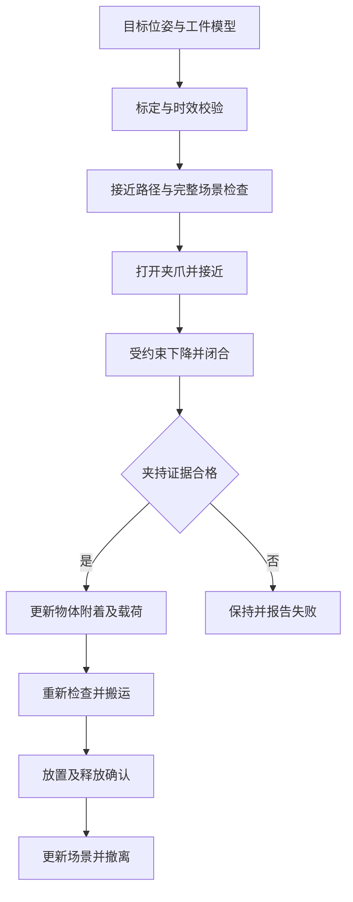

# B601-RS：从指定点夹取到视觉夹取、电弧焊

调研开始：2026-10-18；结论整理：2026-10-19，Asia/Shanghai。

离线准备更新：用户暂不能操作实机，已增加[视觉回放、官方 OBB 算法验证及 J7 采样工具](../离线视觉回放与J7采样_2026-10-19.md)。官方位姿估计使用保存的合成检测框与深度实际执行；未运行 YOLO/相机或实机。原优先顺序不变。

后续实现更新：用户确认先指定点/J7判定、再复现官方视觉 Demo。指定点表单与 `grasp` 条件步骤已加入主工程源码，见[实现与验收边界](../指定点夹取与J7判定_2026-10-19.md)。下文“现有程序仅四类动作”是调研时的源码快照；实机夹持、恢复核查与后端部署仍未验收。

用户已确认：**相机尚未选定；焊接指金属零件电弧焊**。本报告以当前 B601-RS 工程为对象，不假设已有工业焊机、焊枪、焊缝传感器或合格焊接工作站。

## 1. 结论与优先顺序

**下一步可以开始指定点夹取。第一件事是建立经过测量验证的坐标与工具基准，再完成受约束的夹取任务。** 推荐顺序：

1. 收尾当前控制底座：参数恢复锁、持续运行、夹爪与停止语义的实体核验。
2. 固定工装、已知抓取位姿：接近 → 下降 → 闭合 → 确认夹持 → 抬升 → 搬运 → 放置 → 确认释放 → 撤离。
3. 相机辅助定位：先标记物/规则工件，再固定类别，再复杂杂乱工件。
4. 电弧焊：焊枪与工件标定 → 无弧轨迹验收 → 焊机接口模拟 → 工艺试片 → 经验证的受控起弧。

现阶段可以开展上述软件与离线实验；**还没有证据证明本机已经具备生产级自主抓取或电弧焊能力**。识别准确率、编码器 FK 到位、厂商重复定位指标，分别不能代替真实工具定位误差、成功夹持、焊缝质量。

## 2. 当前进度：依据与缺口

核对了用户提供的两段聊天：

- [控制与初始姿态记录](codex://threads/01a13e02-997e-7540-9723-8838e8bec1a4)
- [重启、恢复锁与快捷调速](codex://threads/01a144e1-f673-79c2-9d4c-539ea322ca55)

同时核对当前源码、运行记录与 Basic Memory。历史记录存在被后续变更覆盖的状态；以下不把历史测试数量相加，也不把历史 PID 当作当前在线状态。

| 能力 | 已有依据 | 进入自主作业前还缺什么 |
| --- | --- | --- |
| 手动输入 | 键盘、标准手柄、TCP 拖拽、速度倍率、Ruckig/CSP 共用通路 | 实体手柄、长时运动、抖动与异常保持复测 |
| 指定坐标到点 | 有界 IK、路径预览、到位判据、统一执行器 | 实测 TCP/工件坐标标定，世界坐标绝对误差测量 |
| 程序控制 | 版本化 JSON、示教、整套预览、暂停/继续/取消、J7 步骤 | 条件执行、夹持验证、载荷变化后的路径检查 |
| J7 | 同一 CAN 工作者、独立反馈与恢复、位置开合 | 电机角度与开口宽度映射、接触判定、夹持力与滑落验证 |
| 相机/算法接口 | 图像显示、HTTP 协议、外部识别/规划接口 | 实际相机、深度与颜色对齐、时间同步、手眼标定、实际模型 |
| 碰撞检查 | 当前执行链有自身/名义载荷等保护；另有 MoveIt 抓放示例 | 当前主通路的桌面、夹具、线缆、工具和被抓物体环境规划 |
| 电弧焊 | 有末端运动和程序基础 | 焊枪 TCP、连续工艺轨迹、焊缝传感、焊机接口、工艺与质量验证 |

**当前最先处理的实机阻塞**：`docs/快捷调速与异常保持_2026-10-18.md` 和最近重启证据记录 `RECOVERY`，事故前参数快照缺失。后续软件已补“使能前持久化快照”，这不能补造事故前的真实参数。自主实机动作必须先按现有恢复流程解决；不能用默认值、无关历史快照或重复重启解除锁。本次没有读取实时总线、改参数、重启服务或移动实机。

**初始姿态的版本差异**：聊天历史出现过“采集当时 J2–J6”的配置；目前 `outputs/twin-console/hardware/support-poses.json` 保存的返回目标是 J2–J6 各 0°、容差 ±3°，采集角仍保存在 `captured_joints`。本次只核对，不修改。支撑返回容差不能拿来当抓取精度。

主要本地依据：`twin_program.py`、`twin_kinematics.py`、`csp_hardware.py`、`csp_gripper.py`、`workbench-api.js`、现有 MoveIt `pick_place.py`。实际源码都在本工程，不在部署包装目录 `1seeed_Robotics` 内。

## 3. 调研方法与证据等级

检索包含中文/英文的固定点抓放、手眼标定、RGB-D、6D 抓取、焊缝提取/跟踪、连续路径、焊机机器人接口、专利与软著。来源优先顺序：官方文档/源码、作者/会议/期刊原始页面、专利全文、高校公开成果。第三方教程和宣传性摘要不作为性能依据。

本轮有三个阅读深度：

- **实现核对**：下载锁定 SHA 的 README、关键源码和可取得的许可证，检查调用生命周期与数据语义。没有执行上游驱动或标定脚本。
- **论文/文档核对**：核对原始出版或作者页面的题名、年份、方法与适用范围。没有把全部文章称作全文复现。
- **初筛线索**：部分期刊全文访问失败，或软著只取得公开列示。明确保留“需全文/登记系统复核”的状态。

`资料索引.json` 保存来源与阅读深度；`outputs/autonomy-research-20261018/github-provenance.json` 保存 10 个仓库的 HEAD SHA；`source-snapshots.json` 保存实际取得的文件、URL 与 SHA-256，包括失败项。GitHub REST API 限流后改用 `git ls-remote` 锁定引用；未虚构版本号或许可证。该锁定是检索时快照，不表示这些仓库已在本机安装或兼容验证。

## 4. 可以直接借鉴的官方路径

Seeed 的 [B601-RS 视觉抓取教程](https://wiki.seeedstudio.com/rebot_arm_b601_rs_grasping_demo/) 已有 Python SDK＋YOLO/OBB 与 ROS 2＋YOLOE 两条路线，并列出 Gemini 2、D405、D435i。第一条要求手眼标定；第二条依赖安装模型/TF 并支持偏移补偿。**“免标定板”不意味着本机外参和误差不需要验证。**

| 候选 | 本轮核对 | 本工程接法 |
| --- | --- | --- |
| [Seeed-Projects/reBot-DevArm-Grasp](https://github.com/Seeed-Projects/reBot-DevArm-Grasp) | 核对手眼求解、自动采集、抓取驱动、配置；驱动会连接/使能，采集脚本含主动运动/重力补偿生命周期 | 优先借鉴感知与标定数据处理；运动输出转换为本工程提案，不运行其独立驱动 |
| [rebot_visual_grasp](https://github.com/xiehuangbao888/rebot_visual_grasp) | 核对 `setup.py`、`grasp_yolo.py`、`align_camera.py`；有 TF、位置补偿、执行服务与启动观察姿态选项 | 作为 ROS 感知候选；禁用独立运动入口，先回放数据；Ubuntu/Jazzy 要单独回归 |
| [MoveIt Task Constructor](https://moveit.picknik.ai/main/doc/tutorials/pick_and_place_with_moveit_task_constructor/pick_and_place_with_moveit_task_constructor.html) | 将抓放划成接近、连接、夹持、附着物体、搬运、释放等任务阶段 | 中期补环境场景、附着碰撞体和任务规划，保留现有唯一硬件执行器 |
| [Pilz 工业规划器](https://moveit.picknik.ai/main/doc/how_to_guides/pilz_industrial_motion_planner/pilz_industrial_motion_planner.html) | PTP/LIN/CIRC 与序列运动能力 | 用于直线接近/焊接路径候选；兼容性与实际跟踪另验 |
| [Scan-N-Plan](https://ros-industrial-consortium.github.io/scan_n_plan_workshop/) | 扫描、重建、工具路径、机器人路径的 ROS 2 框架；文档列出 Humble/Jazzy | 电弧焊前期“扫描→路径”架构参考；它本身不完成焊接工艺认证 |

旧 MoveIt `pick_place.py` 使用单独的规划/动作接口，不能因为它能在模拟夹爪中附着一个方块，就认为已接通当前 CSP 实机夹持链。

### 许可证与部署结论

- Seeed 抓取仓库 README 显示 MIT 徽标；本次根目录 `LICENSE` 请求为 404。ROS 2 抓取包 `setup.py` 声明 Apache-2.0，但本次也未取得根许可证正文。接入/再分发前核对逐文件与上游许可，不用徽标代替完整依据。
- [GraspNet baseline 的许可证](https://github.com/graspnet/graspnet-baseline/blob/main/LICENSE)限定学术或非营利组织非商业研究用途。
- [AnyGrasp SDK](https://github.com/graspnet/anygrasp_sdk)需要机器授权；开放示例不等于核心模型实现完全开源。
- 本次取得的 [FoundationPose](https://github.com/NVlabs/FoundationPose/blob/main/LICENSE) 与 [GraspGen](https://github.com/NVlabs/GraspGen/blob/main/LICENSE)许可证含非商业研究/评估限制；模型、数据和第三方组件还需分别检查。
- [Ultralytics 许可证](https://github.com/ultralytics/ultralytics/blob/main/LICENSE)也应进入交付核查；“YOLO”是方法家族，不代表每个实现和权重许可相同。

这些是选型约束记录，不是对任何商业产品给出许可结论。本轮没有复制上游算法到生产控制通路。

## 5. 指定点夹取：应当怎样定义问题

### 5.1 输入必须是“位姿＋坐标系＋工具”

目标至少包含位置、抓取方向、基准坐标系、单位、工具标定版本、物体尺寸/质量、接近距离与放置条件。当前原生 TCP 是 URDF `gripper_end`；它不自动等于两指实际夹持中心，更不等于换装后的焊丝尖端。

以 `G=gripper_end`、`T=经标定的工具作用点`、`W=工件坐标系`、`O=物体` 表示：

```text
基座中的原生末端目标：

  B_T_G = B_T_W · W_T_O · O_T_T · inverse(G_T_T)

腕部相机观测物体：
  B_T_O(t_img) = B_T_G(t_img) · G_T_C · C_T_O(t_img)

固定相机观测物体：
  B_T_O(t_img) = B_T_C · C_T_O(t_img)
```

变换应采用 SE(3)；内部使用 m/rad/s，界面再显示 mm/度。相机光学坐标和 `base_link` 方向不同，不能直接混用。相机外参/手眼标定可参考 [OpenCV](https://docs.opencv.org/4.x/d9/d0c/group__calib3d.html) 和 [easy_handeye2](https://github.com/marcoesposito1988/easy_handeye2)，时间变换按 [ROS 2 tf2](https://docs.ros.org/en/jazzy/Tutorials/Intermediate/Tf2/Learning-About-Tf2-And-Time-Cpp.html) 的时间语义处理。

**现有接口的一个具体缺口**：`workbench-api.js` 的 `camera_to_base` 是静态矩阵，适合已标定的固定相机。腕部相机随关节运动时，应使用图像时刻的关节/FK 或 stamped TF；不能一直复用静态 `camera_to_base`。默认 `camera-v1`、`rs-identity-v1` 是版本标识，不能证明做过相机/TCP 计量标定。

### 5.2 完整抓取任务有条件分支



“J7 到了关闭角度”“等待 1 秒”都不能作为“物体已夹住”的证据。位置/电流特征可以参与判定，但需针对摩擦、空夹、堵转、物体宽度和夹持力建立实测分类，并配合视觉或独立接触传感。夹持后，规划中的附着碰撞体和负载必须更新。

### 5.3 轨迹层必须区分的能力

- 可达目标不等于沿途可达、不碰桌面。
- 当前程序由关节线段及时间曲线执行；两个 TCP 端点正确，不保证中间 TCP 是直线。
- [Ruckig/RSS 2021](https://www.roboticsproceedings.org/rss17/p015.pdf)解决有速度/加速度/jerk 约束的轨迹生成，不替代场景规划、标定或焊缝跟踪。
- 当前程序逐点停稳的语义适合初步抓放；电弧焊通常需要连续路径及工艺速度控制，不能直接用大量停点拼接后起弧。

## 6. 相机与视觉路线比较

相机还未购买/选定，因此本轮只提出场景匹配，暂不指定某一型号为最终设备。

| 方案 | 适合的第一类任务 | 代价或限制 | 当前建议 |
| --- | --- | --- | --- |
| 固定 RGB＋标记物/平面标定 | 有工装、已知高度、规则物体的平面抓取 | 未知高度/遮挡/曲面不能靠平面映射恢复三维 | 可作为低成本坐标链验证 |
| 固定 D435i / Gemini 2 类 RGB-D | 观察较大桌面、抓取前拍照定位、外部监督 | 需要实测工作距离、视场、反光金属深度有效率与外参 | 第一套通用视觉抓取优先比较 |
| 腕部 D405 | 近距离精细观察、工件局部定位 | 官方标准 D405 理想范围为 7–50cm；腕部遮挡/视场变化和手眼时间链更复杂 | 近距任务明确后作为候选 |
| 腕部 D435i / Gemini 2 | 与官方安装件/教程复用，接近工件再观察 | 安装重量、线缆、最小可用距离与手眼标定需测量 | 与固定相机在同一工件上对照 |
| 工业相机＋线激光焊缝传感器 | 电弧焊前焊缝扫描、经验证后的焊中跟踪 | 光学滤波、曝光、保护、时间同步与现场工艺适配 | 焊接专项选型，独立于普通抓取相机 |

D405 范围来自 [RealSense 官方页面](https://www.realsenseai.com/product-family/d405-series/)。其余相机不在本报告套用未经现场验证的“毫米级精度”数字。SDK 对应 [RealSense](https://github.com/realsenseai/librealsense) 与 [Orbbec](https://github.com/orbbec/OrbbecSDK_v2)。

普通 RGB-D 可用于焊前几何实验；不能据此保证在电弧、烟尘、飞溅或高反金属表面持续得到可靠焊缝深度。焊中传感器选型应与实际焊接方法和试片同步验证。

### 视觉算法升级顺序

1. **标记物/已知 CAD/规则块**：先检验世界坐标链是否准确，与检测网络解耦。
2. **检测/分割＋有效深度＋固定抓取模板/OBB**：适合单层、可俯视、开口宽度已知的规则件。
3. **6D 抓取候选**：用于杂乱堆叠与不规则工件，再加可达/碰撞/夹爪几何筛选。
4. **已知工业零件的 6D 位姿与跟踪**：为装配/焊前定位提供工件姿态；物体位姿仍需转换成具体抓取或工艺位姿。

本阶段不要求自建训练集或从头训练大模型；优先可替换推理接口与可回放的实测数据。

## 7. 论文与会议：方法、用途、边界

下表包含会议、期刊及预印本，明确区分发表渠道；不把作者平台上的成功率移植成本机指标。

| 工作与原始来源 | 渠道/年份 | 对本项目的价值 | 限制/核对程度 |
| --- | --- | --- | --- |
| [MoveIt! Task Constructor](https://ieeexplore.ieee.org/document/8793898/) | **ICRA 2019** | 任务阶段与多方案规划 | 核对出版记录与官方教程；不是 IROS 2019 |
| [GG-CNN / Closing the Loop for Robotic Grasping](https://arxiv.org/abs/1804.05172) | RSS 2018 对应工作/作者预印本 | 轻量闭环抓取思路 | 本机延迟和反馈频率尚未支持相同性能推断 |
| [GraspNet-1Billion](https://openaccess.thecvf.com/content_CVPR_2020/html/Fang_GraspNet-1Billion_A_Large-Scale_Benchmark_for_General_Object_Grasping_CVPR_2020_paper.html) | CVPR 2020 | 6D 抓取与评估基准 | 数据/评估与模型分开；基线软件许可受限 |
| [Contact-GraspNet](https://elib.dlr.de/145798/) | ICRA 2021 | 杂乱点云的 6D 抓取候选 | 核对作者机构页面与仓库，迁移夹爪与依赖需复现 |
| [AnyGrasp](https://doi.org/10.1109/TRO.2023.3281153) | IEEE T-RO 2023 | 空间抓取与时序跟踪 | SDK 机器授权；论文结果不等于本机实测 |
| [FoundationPose](https://nvlabs.github.io/FoundationPose/) | CVPR 2024 | 新物体 6D 位姿估计/跟踪 | 不直接输出合格焊缝、焊枪路径；模型/参考数据和 GPU 条件另验 |
| [GraspGen](https://arxiv.org/abs/2507.13097) | 2025 预印本，本轮未确认正式会议 | 新近扩散抓取与不同夹爪的候选生成 | 作者示例夹爪与 B601 J7 不同；需要几何适配与许可核查 |
| [Self-adaptive seam detection framework](https://www.sciencedirect.com/science/article/pii/S0926580525002614) | Automation in Construction，2025 | 焊缝扫描、提取到轨迹的系统链条 | 原出版页面检索摘要已核对；全文打开失败，待补全文 |
| [A novel weld seam extraction method with semantic segmentation and point cloud feature](https://www.sciencedirect.com/science/article/abs/pii/S0736584525000419) | Robotics and Computer-Integrated Manufacturing，2025 | 语义分割＋几何特征提取焊缝 | 仅出版方可检索摘要，尚未复现 |
| [Automated welding seam extraction and path planning for steel box girders using 3D vision](https://www.sciencedirect.com/science/article/pii/S0926580526002116) | Automation in Construction，2026 | 新近 3D 视觉焊缝与路径方向 | 全文访问失败；具体适用接头、指标与代码待核对 |
| [Tracking any welding point (TAWP)](https://www.sciencedirect.com/science/article/abs/pii/S152661252600530X) | 出版方页面标示 2026 | 将焊点位置作为时序跟踪目标的近期方向 | 仅初筛；不据摘要认定能处理本机电弧干扰 |

**选型结论**：第一阶段用显式位姿与任务状态机；视觉第一版采用规则目标/标记物和简单 RGB-D 路线。6D 大模型在简单路线出现明确瓶颈后再比较。电弧焊的近期论文须围绕确定的材料/接头/传感器补读全文与复现，当前还不足以确定生产工艺方案。

## 8. 电弧焊：独立于夹取的工艺阶段

### 8.1 本机适用性需要先测什么

厂商 [B601-RS 性能测试](https://www.seeedstudio.com/blog/2026/09/09/rebot-arm-b601-rs-performance-durability-tests-payload-repeatability-teleoperation-and-gravity-compensation-2/)与[规格文档](https://wiki.seeedstudio.com/rebot_arm_b601_rs_pinocchio_meshcat/)可作为参考；本机更换焊枪后仍应实测：

- 工具＋支架＋送丝/气管线缆在整个工作空间的质量、质心和扰动力矩。
- 不同姿态、路径方向、温升和线缆布置下的实际 TCP 误差、刚度、回差与跟踪速度波动。
- 新焊枪/焊丝端部 TCP、工件基准、工装重复装夹和焊后变形。
- 焊接电磁环境对 USB/CAN/相机、供电和计算机稳定性的影响，以及工具/电缆的隔离和防护。

这些未完成前，B601-RS 的合理定位是**电弧焊相关算法与无弧轨迹的研究平台候选**，不能承诺已经适合某种焊缝等级或持续生产。厂家重复定位值不能替代上述测量。

### 8.2 推荐技术分工

| 子系统 | 负责内容 | 第一轮可实施内容 |
| --- | --- | --- |
| 视觉与工件定位 | 焊前点云、CAD 配准、焊缝中心线、坡口/接头特征、焊中测量 | 固定试件、无弧扫描；先已知几何，再自动提取 |
| 工艺路径 | 焊枪工作角/行进角、干伸长/距离、速度、起止段、可选摆焊 | 模拟焊枪沿直线/圆弧/拐角连续走，测量路径与速度误差 |
| 机器人规划执行 | 完整工具/场景碰撞、奇异点/限位、连续路径、轨迹反馈 | MoveIt/Pilz 或 Tesseract 的独立仿真比较；最终接原执行器 |
| 焊机适配器 | 就绪、启动、弧稳定、故障、工艺程序、送丝/气体、收弧 | 用模拟器测试状态与超时，具体字段按焊机型号确定 |
| 独立工作站控制 | 起弧许可、急停/门禁等物理联锁及焊接防护 | 选定工作站方案后定义接口，网页心跳不能代替它 |
| 质量评价 | 外观/尺寸、缺陷、必要的试验与追溯 | 按材料、接头和要求制定试片及验收方法 |

[Fronius TPS/i 官方信号说明](https://manuals.fronius.com/html/4204260227/en-US.html)展示了焊机与机器人的独立输入/输出与工艺握手。这是接口设计参考，**不是已选用的焊机型号或通用寄存器表**。

```text
无弧路径合格
  → 校验工件/焊枪/工艺版本
  → 工作站许可与焊机就绪
  → 启动工艺并等待合格反馈
  → 按工艺轨迹运行、监督焊机与跟踪误差
  → 收弧/后送气等按设备工艺完成
  → 冷却与质量检查、保存轨迹和过程记录
```

任何热过程动作都应有独立超时、取消与故障处理；机器人暂停与焊机停止工艺必须协调，不能把夹爪的“保持”语义直接用于持续起弧。恢复通信后不自动继续起弧。

工作站集成可从 [ISO 10218-2:2025](https://www.iso.org/standard/73934.html)的范围入手；钢/镍/钛等熔焊接头缺陷等级可参考 [ISO 5817:2023](https://www.iso.org/standard/80209.html)，但须核对实际材料、适用范围和项目要求。本轮只核对官方标准摘要，没有取得全部规范正文，也没有作合规认证判断。

**焊接继续收敛所需输入**：MIG/MAG/TIG 等工艺、材料与板厚、接头与长度、焊机/送丝机接口、焊枪质量、目标质量与节拍。这些会改变相机/传感器与轨迹方案，不能用统一的默认电流、电压和速度代替。

## 9. 专利与软著调研

### 9.1 代表性专利

| 公开/授权文献 | 公开信息 | 对本项目的启发 | 证据界限 |
| --- | --- | --- | --- |
| [CN107186708B](https://patents.google.com/patent/CN107186708B/zh)，基于深度学习图像分割技术的手眼伺服机器人抓取系统及方法 | B 文献公开日 2020-05-12 | 感知、局部测距与手眼伺服组合已有先例 | 阅读正文/权利要求结构；不判断本项目落入其保护范围 |
| [CN109693018B](https://patents.google.com/patent/CN109693018B/zh)，自主移动机器人焊缝视觉跟踪系统及跟踪方法 | A 2019-04-30，B 2021-04-27 | 视觉/线激光、跟踪、机器人和焊机联动 | 核对原文；移动机器人结构与 B601 不同 |
| [CN106312398A](https://patents.google.com/patent/CN106312398A/zh)，一种可自动识别与跟踪焊缝的焊接机器人 | A 类公开文献 | 前后视觉、焊缝识别/跟踪的工程组合 | 本轮仅检索初筛；需进一步核对同族、有效权利要求与状态 |

技术选型不能依赖“专利摘要写了可实现”来证明工程成熟度；公开文献也不等于允许照搬。正式商业实施或专利申请前，需在 [国家知识产权局检索系统入口](https://www.cnipa.gov.cn/art/2023/2/13/art_3166_182074.html)按确定方案检索分类号、同族、法律状态与权利要求。本轮不是穷尽检索或自由实施分析。

### 9.2 可核验来源中的软著线索

| 软件名称 | 公开列示登记号 | 原始公开来源 | 本轮结论 |
| --- | --- | --- | --- |
| 双目立体视觉的目标识别定位与机器人抓取软件系统 | 2021SR1312284 | [天津工业大学教师页面](https://kz.tiangong.edu.cn/2016/0616/c5028a36034/page.psp) | 页面列示成果；未在登记中心逐项核验 |
| 基于双目视觉的液压机械臂抓取软件系统 | 2022SR1338218 | 同上 | 可作为同类软件功能检索线索，不代表可取得源码 |
| 新时达 SA 系列焊接机器人离线编程软件 | 2018SR245001 | [上海交通大学教师页面](https://me.sjtu.edu.cn/teacher_directory3/chenxiaobo.html) | 搜索索引可检索列示，正文抽取未显示该段，保留待复核 |
| 大型薄壁贮箱环缝装焊过程在位测量软件 | 2019SR0254715 | 同上 | 同为公开列示线索，非登记中心认证 |

中国版权保护中心本次直接访问失败；没有把检索线索表述成完整登记库结果。[国家版权局《计算机软件著作权登记办法》](https://www.ncac.gov.cn/xxfb/flfg/bmgz/202410/P020241015604759788122.pdf)是登记规则的官方依据。软著名称/证书不能替代算法论文、源代码和性能实验，也不能证明组合功能具有专利新颖性。

如以后为本项目整理成果，可以保留原创任务状态机、标定与误差评估、工艺执行与追溯等模块的版本、作者、源代码和用户手册；第三方组件来源与许可单列，不将其署作自研。本轮不办理申请，也不声称已形成可授权的新专利。

## 10. 实施与验收计划

以下是**建议立项门槛/实验指标**，不是已达到的性能或通用行业标准。精度应根据工件尺寸、夹爪余量和焊缝要求再定。

| 阶段 | 做什么 | 建议验收证据 | 当前状态 |
| --- | --- | --- | --- |
| G0 底座收尾 | 正常参数恢复、连续控制与停止、J7 标定 | 恢复记录完整；现场低速验证后逐步延长；记录反馈年龄、跟踪误差、停机原因、夹爪空夹/夹持/堵转样本 | 尚未完成实体验收 |
| G1 已知点夹取 | 固定工件与工装、实测 TCP、抓放条件状态机、完整场景检查 | 示例可先用约 20mm 规则块，外部测量 P95 定位误差暂以 ≤2mm 为立项目标；20 次至少 19 次成功，无碰撞/滑落，失败保持并正确报告 | 本轮完成离线候选生成与运动学检查，未实机 |
| G2 相机辅助 | 同一工件比较相机、标记物/平面、手眼和时间链 | 分训练/标定点与独立验证点；至少跨视场位置与距离，报告误差分布、深度失效率、处理延迟、重装漂移 | 待选相机/采数据 |
| G3 视觉自主抓放 | 固定类别→变化姿态→遮挡/杂乱，必要时比较 6D 方法 | 按场景预先固定至少 30 次试验；分别报告检测、定位、可达、夹持、放置成功率及总周期，不能只报检测 AP | 待 G1/G2 |
| G4 无弧焊接 | 模拟焊枪/真实工具未起弧、工件定位、连续路径、焊机 IO 模拟器 | 外部路径测量、速度波动、拐角/奇异点、超时/取消、焊机故障与通信恢复测试；起弧始终禁止 | 设计完成，尚未实现完整链路 |
| G5 电弧试片 | 选定焊接工艺与合格工作站，验证试片 | 工艺人员确定参数/工艺与质量标准；同步记录机器人、焊机、传感器与质量结果 | 设备/工艺未确定，不具备起弧条件 |

G1 的“20 次/19 次”和“2mm”用于第一轮规则块实验，不足以证明生产可靠性。进入更小工件或焊接时必须重新分配误差预算和做更多验证。G0 实机阻塞不妨碍离线 G1、视觉数据回放或 G4 工艺仿真；它阻止的是依赖本机实际运动的验收。

### 误差与实验记录

至少拆分：机器人 FK 模型误差、关节回差/挠度、TCP、工件装夹、相机内参/深度、手眼、时间错位、抓取模板。报告实测均值/P95/最大值以及失败样本；系统误差不能默认相互独立后直接做平方和。对比同一工件/光照/视距，保存原始 RGB、深度、CameraInfo、时间戳、关节反馈、标定版本和任务结果。

## 11. 本轮实际交付与未完成范围

### 已完成

- 两个聊天、当前源码和最新恢复记录的交叉核对。
- 本报告、资料索引、10 个仓库引用与关键文件快照核对。
- 离线 `examples/autonomy/fixed_pick.py`：明确 XYZ/RPY、坐标/单位、TCP、候选工作区与速度；生成抓取/放置候选及强制标出的验证阶段。
- `test_fixed_pick.py`：原执行器拒绝提案格式、夹持/释放验证顺序、输入边界、采样预算与几何采样检查。
- 对示例候选调用本工程原生 `TwinKinematics` 检查，结果见 `kinematics-verification.json`；它只说明示例运动学，不包含碰撞、实物夹持或焊接验收。

### 为什么离线提案不能直接导入运动

现有动作格式只有 `joint/pose/gripper/wait`，没有“确认夹持/释放并更新附着物”的条件动作。本轮采用独立的 `b601-fixed-pick-proposal/1.0`，测试确认原导入器拒绝它；不把 `wait` 伪装成夹持确认。`hardware_execution_allowed=false` 是说明字段，真正的隔离来自**没有执行 API、不同格式且原导入器拒绝**，不是依赖这个布尔值作为安全认证。

提案中的 TCP 采样只是几何候选，未取得环境/载荷/时间认证；首段尚需结合实际关节起点规划。闭合角为示例电机角度，不能拿来夹特定物体。工具方向需要现场标定验证，示例 RPY 不宣称是俯视夹持方向。

使用方法见 [原型说明](../../examples/autonomy/README.md)。本轮没有启用相机、发送图像到外部服务、训练模型、改变控制底座/恢复记录、启动独立 CAN 所有者或实际起弧。

**下一项具体工作**：先完成恢复核查与 TCP/J7/工件坐标的实测记录；用明确尺寸/质量的一个规则工件补齐环境规划与夹持证据，再把 G1 的条件阶段接入现有统一执行器。相机可并行进行离线样本比较。电弧焊优先做焊枪模型与无弧连续路径，不设默认起弧动作。
