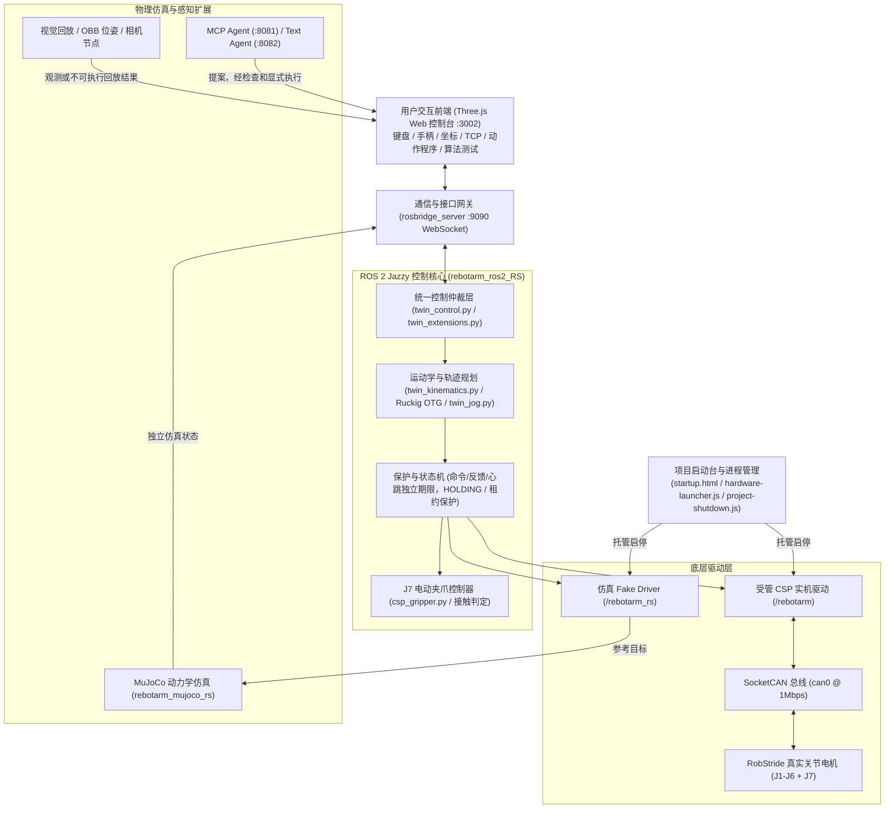
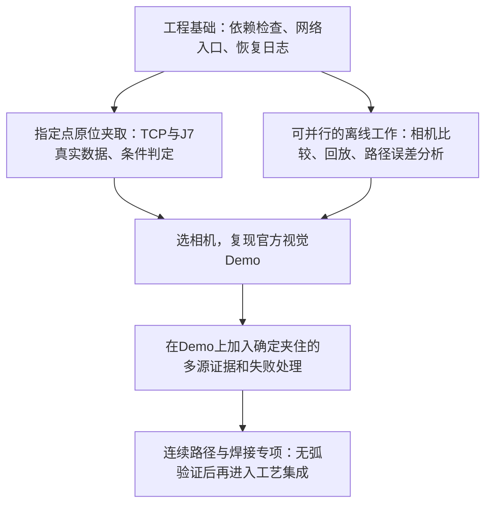

# B601-RS 工作空间架构体系、全文档功能索引与系统改进建议指南

> **2026-10-19 评审修订**：模块索引可用；原稿的厂商、实测进度、统一超时、失持监视及若干改进承诺不准确，已对照源码和专项记录修正。第二部分是主要文档导航，历史文档不代表当前实现。第三、四部分为评审后的判断与验收路线；实施结果见[本轮改进记录](架构建议评审与改进_2026-10-19.md)。原稿保存在 `docs/history/架构建议_评审前_2026-10-19.md`。

> **文档定位**：本文档旨在全面梳理 `ReBot_Arm_DigitalTwin_RS` 工程的系统架构、数据链路、运行体系与各文档职责，并针对当前系统的安全隐患、技术瓶颈及功能缺失提出深度诊断与具体的工程改进建议，供后续系统重构、实机调试与功能扩展时查阅定位。

---

## 第一部分：工作空间核心定位与系统全景架构

### 1.1 项目背景与对象
本工程是专为 **Seeed reBot Arm B601-RS 六轴机械臂（RobStride 电机）** 配套 **J7 电动夹爪**（合计 7 轴）打造的**数字孪生、多模式交互控制与物理仿真系统**（动力学精度尚未实机辨识）。系统运行环境推荐为 Ubuntu 24.04、ROS 2 Jazzy、Python 3.12 与 Node.js 22及以上（须提供全局 WebSocket/fetch）。

### 1.2 核心系统组成
整个工作空间由四个核心子系统构成：

1. **统一 Web 数字孪生工作台 (`reBotArm_simulator-RS`)**
   - **双模型实时对照**：在浏览器中基于 Three.js 实时渲染“实线测量反馈模型”（编码器真实数据）与“半透明目标影子模型”（期望轨迹），直观呈现控制跟踪误差。
   - **多输入融合**：同一套底层链路支持绝对坐标到点、键盘微动、标准游戏手柄（RB 为持续输入许可，准备/接管/出力由独立状态机管理）、TCP 空间拖拽（支持姿态锁定）和 J7 夹爪开合。
   - **向导式启动与退出**：提供 `startup.html` 步骤式启动台，引导检查 ROS、启用 CAN、启动只读反馈；配套带状态互锁的 `project-shutdown.js` 安全退出服务。
   - **任务编排与算法监视**：支持版本化 JSON 动作程序（示教、预览、直接执行、暂停继续）以及外部控制算法（PID、LADRC、MPC 等）的闭环试跑与监视。

2. **ROS 2 核心控制系统 (`rebotarm_ros2_RS`)**
   - **Fake 驱动 (`fake_rs_driver.py`)**：在 `/rebotarm_rs` 命名空间下提供不依赖硬件的仿真驱动。
   - **受管 CSP 实机驱动 (`csp_twin_driver.py`, `csp_hardware.py`)**：独占 SocketCAN 线程，锁定 RobStride CSP SDK（commit `6415d431`）。坚持“默认只读、显式租约使能”，通过许可与租约限制写入（不等同于硬件安全认证）。
   - **平滑轨迹与安全仲裁**：集成 Ruckig 三阶 Jerk 约束轨迹生成器；命令500 ms、反馈600 ms、操作者心跳700 ms等独立保护；完整控制中的部分通信异常进入HOLDING，其他故障按各自分支处理、自碰撞与名义重力校验、越界拦截及故障锁定保护。
   - **J7 专用控制**：独立的 J7 电动夹爪状态机，支持行程、速度与电机接触相电流综合判定的 `grasp` 条件步骤。

3. **MuJoCo 物理仿真**
   - `rebotarm_mujoco_rs` 接收参考并发布独立仿真状态；Fake参考跟随与MuJoCo动力学状态不能视作已校准的物理闭环。提供虚拟俯视相机、腕部相机及颜色检测抓取演示；另有基于 WebAssembly 的轻量级网页仿真演示 `web_mujoco`。

4. **运维与自动化工具链**
   - `./rebotarm` 统一 CLI 工具、Linux 桌面启动器、CAN 配置脚本与离线自动化回归测试套件。

---

## 第二部分：工程全文档功能索引与职责目录

为了便于后续精准定位与分工改进，现将工作空间内主要文档按功能维度划分为 7 大类别：

### 2.1 根目录核心总览与用户/开发者指南

| 文档名称 | 路径 | 核心功能与职责说明 |
| :--- | :--- | :--- |
| **README.md** | `README.md` | **项目总纲**。介绍工程定位、系统入口（3002端口）、默认控制参数边界、安装迁移要求、实机验收状态与核心文档导航。 |
| **快速启动指南.md** | `快速启动指南.md` | **日常操作手册**。专为一线人员编写的“傻瓜式”指南，包含桌面图标启动、按步检查连接、手动/程序控制、安全支撑与退出流程。 |
| **USER_MANUAL_ZH.md** | `USER_MANUAL_ZH.md` | **完整用户手册**。系统介绍工作台组成、系统依赖、MuJoCo 物理仿真、网页控制、视觉抓放演示、真机安全规则与常见操作排障。 |
| **DEVELOPER_GUIDE_ZH.md** | `DEVELOPER_GUIDE_ZH.md` | **完整开发者手册**。深入讲解源码架构、ROS 2 各节点通信拓扑、编译构建步骤、二次开发扩展规范与软硬件安全红线。 |
| **DATA_FLOW_RS_ZH.md** | `DATA_FLOW_RS_ZH.md` | **数据流与链路处理手册**。使用详尽流程图拆解从前端拖拽、rosbridge、ROS话题与历史控制路径。其125Hz描述不适用于当前受管CSP路径；当前设计20ms控制周期，实际时序见10月18日小幅实测记录。 |
| **DM_RS_COMPARISON_ZH.md** | `DM_RS_COMPARISON_ZH.md` | **DM 与 RS 架构对比手册**。对比达妙（串口/POS_VEL/500Hz）与RobStride RS电机路径（SocketCAN/CSP/MIT，原文125Hz为历史实现）在总线、模式、反馈滤波及安全状态机上的差异。 |
| **LEADER_TELEOP_ROS_PLAN_ZH.md** | `LEADER_TELEOP_ROS_PLAN_ZH.md` | **主从遥操作方案设计**。记录将 Arm102 主手通过串口 SDK 接入 ROS 2 控制从臂跟随的架构规划、会话管理与安全映射策略。 |
| **LEADER_TELEOP_TEST_ZH.md** | `LEADER_TELEOP_TEST_ZH.md` | **主从遥操作实测记录**。记录主手端口扫描、串口权限配置、标定零点、角度映射及现场跟随联调的测试记录。 |

---

### 2.2 交付总纲与系统运维文档（`docs/` 目录）

| 文档名称 | 路径 | 核心功能与职责说明 |
| :--- | :--- | :--- |
| **项目交付文档_2026-10-17.md** | `docs/项目交付文档_2026-10-17.md` | **正式交付技术总纲**（对应 `docs/交付/` 下 docx/pdf）。规定交付范围、软硬件部署与迁移步骤、动作程序数据合同、备份机制以及未通过项与实机验收边界。 |
| **详细启动与排障_2026-10-17.md** | `docs/详细启动与排障_2026-10-17.md` | **系统排障全书**。详述依赖安装、嵌套 Git 依赖处理、CAN 总线权限配置、网络/端口故障、通信只读恢复等底层排障方案。 |
| **文件说明.md** | `docs/文件说明.md` | **代码资产职责说明书**。对 ROS 2 源码、网页前端脚本、测试套件、构建生成物及上层分支资产按文件/文件组逐一说明职责划分。 |
| **系统入口整理_2026-10-18.md** | `docs/系统入口整理_2026-10-18.md` | **操作入口规范**。规范项目启动台、工作台左侧导航栏、各项控制子面板的职责边界，避免多控制链路混用。 |
| **左侧工具栏与项目启动台_2026-10-17.md** | `docs/左侧工具栏与项目启动台_2026-10-17.md` | **界面布局演进记录**。记录统一整合左侧抽屉工具栏、将零散控制面板模块化集成到启动台与操作台的设计演进。 |
| **一页操作总台_2026-10-17.md** | `docs/一页操作总台_2026-10-17.md` | **一体化控制台设计说明**。记录实现单页面整合 3D 显示、反馈对照、遥操作、程序管理与调参的实现细节。 |
| **项目一键退出_2026-10-18.md** | `docs/项目一键退出_2026-10-18.md` | **安全关停逻辑规范**。阐明后端一键终止服务的实现逻辑，普通退出先要求现场支撑并失能，再由驱动只读封存确认后结束进程；不能用此流程延迟紧急停止。 |
| **重启排障_2026-10-18.md** | `docs/重启排障_2026-10-18.md` | **服务恢复指南**。针对后台守护进程残留、CAN 租约未释放、端口被占用等情况的定位与恢复指引。 |

---

### 2.3 控制体系、运动学与控制算法文档（`docs/` 目录）

| 文档名称 | 路径 | 核心功能与职责说明 |
| :--- | :--- | :--- |
| **完整控制操作说明.md** | `docs/完整控制操作说明.md` | **实机控制模式指南**。介绍从只读监视到完整控制模式的切换条件、速度/时限限制、现场安全核查与控制授权流程。 |
| **统一控制与相机对照.md** | `docs/统一控制与相机对照.md` | **虚实同步与视觉对照手册**。说明真实编码器反馈模型与目标影子模型的对照机制，以及浏览器端接入相机视频流进行视觉比对的操作说明。 |
| **Ruckig共用运动方案_2026-10-17.md** | `docs/Ruckig共用运动方案_2026-10-17.md` | **Ruckig 算法集成说明**。记录集成第三方 Ruckig OTG 库，实现限速度、限加速度、限加加速度（Jerk）多轴平滑插补的实现方案。 |
| **共用运动配置与反馈调参_2026-10-17.md** | `docs/共用运动配置与反馈调参_2026-10-17.md` | **参数整定规范**。说明加减速比例、Jerk 曲线、五次多项式和反馈滤波参数的调试方法与存储规范。 |
| **MIT与扩展反馈控制_2026-10-17.md** | `docs/MIT与扩展反馈控制_2026-10-17.md` | **MIT/阻抗控制方案**。记录在 CSP 之外提供 MIT 位置 PD 模式的实现机制，以及外部控制器闭环接管的目标接口。 |
| **控制算法接入.md** | `docs/控制算法接入.md` | **算法接入通信协议**。定义外部控制器通过 HTTP/WebSocket 接入当前系统的关节状态输入协议、期望目标格式及闭环监视机制。 |
| **算法接入与程序工作台.md** | `docs/算法接入与程序工作台.md` | **算法与编排集成指南**。介绍网页工作台中算法实验区与动作程序区的协作模式，以及外部视觉/大模型适配器的对接规范。 |
| **官方参数对齐_2026-10-16.md** | `docs/官方参数对齐_2026-10-16.md` | **电机参数对齐记录**。记录将软件各关节最大角速度、限位参数与睿尔曼官方出厂标称值进行对比与安全限缩对齐的依据。 |
| **初始稳定姿态.md** | `docs/初始稳定姿态.md` | **机械安全姿态定义**。规定机械臂 J2–J6 初始机械稳定姿态的角度参数，以及复位时的回退轨迹与保护规则。 |
| **重置控制状态.md** | `docs/重置控制状态.md` | **控制状态重置规范**。说明清除当前运动租约、中止未完成任务、复位控制器内部状态机并恢复默认保护参数的执行逻辑。 |
| **平滑遥操作_2026-10-16.md** | `docs/平滑遥操作_2026-10-16.md` | **遥操作平滑处理机制**。记录键盘手柄输入死区、加速度渐变、松开安全键自动软减速制动等遥操作体验优化。 |
| **快捷调速与异常保持_2026-10-18.md** | `docs/快捷调速与异常保持_2026-10-18.md` | **调速与断联保护机制**。说明界面档位（低速/常速/高速）的倍率生效规则，以及发生通信中断时保持当前物理位置的 HOLDING 机制。 |
| **连续坐标与控制平滑_2026-10-16.md** | `docs/连续坐标与控制平滑_2026-10-16.md` | **坐标平滑与起点衔接**。记录解决目标点连续下发时的速度抖动、以及实际测量值与计划起点误差消除的技术实现。 |
| **命令500ms与运动平滑_2026-10-17.md** | `docs/命令500ms与运动平滑_2026-10-17.md` | **500 ms 看门狗机制**。记录 500 ms 命令时效窗口的设计，保证指令丢失时能在时限内平滑减速刹车而非突兀掉电。 |
| **自定义速度与轮询优化_2026-10-16.md** | `docs/自定义速度与轮询优化_2026-10-16.md` | **自定义速度与总线优化**。说明用户自定义速度参数在控制器内的映射机制，以及减少总线轮询开销的优化策略。 |
| **通信保持与七轴手动控制_2026-10-16.md** | `docs/通信保持与七轴手动控制_2026-10-16.md` | **七轴同步控制规范**。记录将 J1–J6 六个机械臂关节与 J7 夹爪合并纳入统一面板、同频下发指令的方案。 |
| **国庆快乐书写程序.md** | `docs/国庆快乐书写程序.md` | **复杂轨迹示例**。说明末端轨迹生成工具（书写“国庆快乐”字样）的数据格式、逆解检查与 ROS 路径高亮预览。 |

---

### 2.4 自主作业、视觉回放与前沿调研文档

| 文档名称 | 路径 | 核心功能与职责说明 |
| :--- | :--- | :--- |
| **指定点夹取与J7判定_2026-10-19.md** | `docs/指定点夹取与J7判定_2026-10-19.md` | **自主抓取步骤规范**。定义工作台“指定点夹取”表单，涵盖接近、下探、闭合判定、电机接触电流/位置综合检测的 `grasp` 步骤状态机。 |
| **离线视觉回放与J7采样_2026-10-19.md** | `docs/离线视觉回放与J7采样_2026-10-19.md` | **离线感知验证工具**。提供基于合成 RGB-D 数据的基座坐标换算回放、隔离环境运行官方 OBB 位姿算法，以及 J7 反馈离线数据采样与分布统计分析。 |
| **自主夹取与电弧焊调研_2026-10-19.md** | `docs/research/自主夹取与电弧焊调研_2026-10-19.md` | **工业场景扩展调研报告**。系统分析机械臂进行固定点抓取、相机辅助视觉定位以及金属零件电弧焊所需的技术链、硬软件缺口及分阶段验证路线。 |
| **资料索引.json** | `docs/research/资料索引.json` | **外部资料索引清单**。收录相关开源算法库、上游驱动仓库、技术规范与测试数据集索引。 |
| **需求与扩展实施清单_2026-10-16.md** | `docs/需求与扩展实施清单_2026-10-16.md` | **需求追踪矩阵**。记录项目从早期基础控制演进到数字孪生工作台过程中的十项重点实施需求与验收标准。 |

---

### 2.5 验收测试与现场核查报告

| 文档名称 | 路径 | 核心功能与职责说明 |
| :--- | :--- | :--- |
| **交付核对_2026-10-16.md** | `docs/交付核对_2026-10-16.md` | **阶段交付核对清单**。核对当时控制台各模块完成度、代码状态与遗留事项。 |
| **可视工作台验收_2026-10-16.md** | `docs/可视工作台验收_2026-10-16.md` | **前端控制台验收单**。记录网页模型加载、TCP 拖拽反馈、影子同步与相机组件的测试结果。 |
| **网页真机验收_2026-10-16.md** | `docs/网页真机验收_2026-10-16.md` | **真机通信验收报告**。记录 3002 网页连接真实硬件时的编码器数据上报延迟、小范围微动与界面刷新表现。 |
| **实机小幅试验_2026-10-15.md** | `docs/实机小幅试验_2026-10-15.md` | **首次真机试验记录**。记录首次在实机上执行 J6 小范围微动测试的数据与安全观察。 |
| **小幅实机验证_2026-10-18.md** | `docs/小幅实机验证_2026-10-18.md` | **小幅模式安全验证单**。记录小范围受限运动模式的实际动作校验，修正前端界面角度显示与机械原点偏差。 |
| **手动指令优化与软件验收_2026-10-18.md** | `docs/手动指令优化与软件验收_2026-10-18.md` | **控制逻辑软件回归报告**。记录对点到点、键盘手柄微动在无硬件隔离 ROS 环境下的回归测试结果。 |

---

### 2.6 故障排查、通信修复与时序专项记录

| 文档名称 | 路径 | 核心功能与职责说明 |
| :--- | :--- | :--- |
| **实机异响与模式残留排查_2026-10-16.md** | `docs/实机异响与模式残留排查_2026-10-16.md` | **异响与死锁排障**。排查由于保持期间速度超调触发硬件限幅导致的异响，确立 RECOVERY 锁定保护与恢复时序。 |
| **起点边界误判修复_2026-10-16.md** | `docs/起点边界误判修复_2026-10-16.md` | **限位误报排障**。排查使能瞬间传感器浮动导致边界限位越界误判的问题，确立轨迹生成前读取新鲜静态姿态的校验逻辑。 |
| **运动中失能与五倍速度_2026-10-16.md** | `docs/运动中失能与五倍速度_2026-10-16.md` | **速度突变与失能排障**。分析运动中失能撤力的日志与电流曲线，记录速度上限、运动中失能及保护调整；文件名中的“五倍速度”不构成单位换算错误根因已证实的结论。 |
| **重置越界与键盘排查_2026-10-16.md** | `docs/重置越界与键盘排查_2026-10-16.md` | **键盘失效排障**。定位键盘控制未响应原因，修复因逆解目标超出机械臂物理工作空间引发的重力计算报错。 |
| **网页心跳与绘制分离_2026-10-16.md** | `docs/网页心跳与绘制分离_2026-10-16.md` | **看门狗超时排障**。将前端 60 Hz 的 Three.js 动画重绘循环与 10 Hz 的后端看门狗心跳通信解耦，防止页面卡顿误切 HOLDING。 |
| **逆解与电机使能修复_2026-10-16.md** | `docs/逆解与电机使能修复_2026-10-16.md` | **逆解算法与使能修复**。改进阻尼最小二乘（DLS）逆解算法处理姿态奇异，严格区分“电机准备”与“电机使能”状态。 |
| **程序直接执行与启动反馈修复_2026-10-16.md** | `docs/程序直接执行与启动反馈修复_2026-10-16.md` | **程序自动执行优化**。优化点击“使能并执行程序”时的自动切换租约、接管控制与起点平滑衔接流程。 |
| **通信轮询与只读重试修复_2026-10-17.md** | `docs/通信轮询与只读重试修复_2026-10-17.md` | **CAN 掉线自愈优化**。优化底层线程读取电机反馈的超时重试策略，防止瞬间丢包导致整个控制环崩溃。 |
| **反馈过期与持续保持_2026-10-16.md** | `docs/反馈过期与持续保持_2026-10-16.md` | **反馈延迟优化**。定位 J1 关节在高负载下偶尔出现的反馈滞后现象，优化持续保持状态下的判据容忍度。 |
| **侧栏与TCP及反馈诊断_2026-10-18.md** | `docs/侧栏与TCP及反馈诊断_2026-10-18.md` | **界面诊断增强**。在工作台侧边栏增加底层 CAN 通信质量、反馈延迟、TCP 实际解算偏差等诊断指标的实时展示。 |
| **反馈画面节奏与手柄图解_2026-10-18.md** | `docs/反馈画面节奏与手柄图解_2026-10-18.md` | **交互体验优化**。在界面增加手柄物理按键图解（按住 RB 使能，左摇杆/十字键移动，A/B 键控制夹爪），并优化 3D 渲染节流。 |
| **通信恢复与手柄开合_2026-10-18.md** | `docs/通信恢复与手柄开合_2026-10-18.md` | **外设热插拔优化**。排查 USB 手柄插拔重连时的事件监听恢复，并确保 A/B 键控制夹爪动作平滑。 |

---

### 2.7 子模块与历史文档

| 文档名称 | 路径 | 核心功能与职责说明 |
| :--- | :--- | :--- |
| **rebotarm_ros2_RS/API_zh.md** | `rebotarm_ros2_RS/API_zh.md` | **ROS 2 接口规格书**。详细罗列 ROS 话题、服务、Action 动作定义，包含关节状态、TCP 目标、使能切换与遥操作接口。 |
| **rebotarm_ros2_RS/README_zh.md** | `rebotarm_ros2_RS/README_zh.md` | **ROS 2 包架构总览**。说明 `rebotarmcontroller`、`rebotarm_bringup`、`rebotarm_mujoco_rs` 等功能包的组织方式与编译步骤。 |
| **rebotarm_ros2_RS/third_party/README.md** | `rebotarm_ros2_RS/third_party/README.md` | **第三方 SDK 依赖说明**。记录本工程引用的 RobStride 控制库版本、上游仓库来源与特定提交哈希信息。 |
| **reBotArm_simulator-RS/README.md** | `reBotArm_simulator-RS/README.md` | **Web 控制台工程说明**。说明 Node.js 后端服务、PWA 缓存机制与静态资源目录规范。 |
| **web_mujoco/README.md** | `web_mujoco/README.md` | **WASM MuJoCo 说明**。基于 Vite 搭建的独立网页 MuJoCo 物理演示指南。 |
| **README_交付整理前_2026-10-17.md** | `docs/history/README_交付整理前_2026-10-17.md` | **历史快照文档**。保留项目 2026-10-17 交付整理前的旧版总览说明，供追溯早期历史架构参考。 |

---

## 第三部分：现状核实与剩余问题

以下区分代码能力、已有实测与待验证推断，不能用历史记录推定当前运行状态。

### 3.1 撤力与断电风险：需要机械措施和故障策略共同处理

撤力后失去支撑的风险需要重视。原稿关于直驱/减速器类型、抱闸和配重的具体断言缺少本机BOM或实物核查依据，应现场确认。软件HOLDING依赖供电、驱动和通信，不能提供断电支撑。

不能笼统说“500ms超时/断网都会立即撤力”：当前命令、反馈、心跳和手动输入采用不同期限；完整控制下部分通信或参考异常进入保持，其他故障和显式失能走各自处理分支。HOLDING也不等于已获独立物理停机证明。见 `csp_hardware.py`、`csp_hold.py` 及[通信恢复记录](通信恢复与手柄开合_2026-10-18.md)。

### 3.2 连续工艺路径能力尚未验收

逐点IK、关节Ruckig插补及逐点到位不保证TCP在点间严格沿直线、恒速穿点。已有雅可比/阻尼最小二乘速度求解，不是从零缺失该能力；但它不等同于完整笛卡尔连续路径执行器。需实测路径偏差、姿态误差、速度波动、分支连续性、奇异点和碰撞余量，不能断言当前必然关节跳变或抖动。

当前到点夹取可先在经检查的工作区低速验收；插装、沿面加工和焊接需要另设工艺精度验收。Ruckig解决受限状态间轨迹生成，不能仅因加入它就承诺实际末端严格直线。依据：[Ruckig官方文档](https://docs.ruckig.com/)；本项目锁定版本仍为0.12.2，本次未升级。

### 3.3 J7已有条件判定，仍缺物理标定与独立夹物证据

- 真实控制采用0–5rad电机量，尚无可用的毫米开度/牛顿夹力标定。
- `grasp`综合空夹端点间隙、闭合行程、速度、电流、独立样本与持续时间。`twin_grasp.py`已有holding阶段的有限失持监视，失败会阻止后续程序运动；因此“没有任何掉落检测”不准确。
- 现有输出明确为 `motor_contact`、`object_verified=false`。触碰夹具、内摩擦或夹到目标仍可能混淆；没有真实片段就不能自动给出阈值。新增传感器也须验证误报、漏报和延迟。
- J7恢复日志原先仅临时文件替换，缺少文件和目录fsync；本轮已补齐，失败时禁止开始参数写入/使能。见[指定点夹取](指定点夹取与J7判定_2026-10-19.md)与[离线采样](离线视觉回放与J7采样_2026-10-19.md)。

### 3.4 有进程互锁，但网络入口原先存在缺口

启动/退出管理已有工程入口核对、进程出生时间、反馈检查和实机只读封存，不是单靠PID文件。实机异常后自动重启可能掩盖恢复问题，不应作为默认修复。

本轮修改前：Node监听所有网卡；启动/实机/工作区API已有局部本机/来源检查，但配置令牌、聊天代理和快捷启动未统一覆盖；三个ROSBridge启动入口显式绑定0.0.0.0。本轮已将Node及三个ROSBridge入口改为127.0.0.1，并统一API来源检查。

这是缩小网络暴露面，不是完整认证方案。ROSBridge直连没有由本轮提供用户身份认证或浏览器Origin过滤；本机其他进程、恶意网页的直连风险、ROS DDS发现网络仍需单独治理。不能据此宣称ROS系统已经完成访问控制。新源码须经受控重载才作用于既有进程。

### 3.5 依赖检查误报已修复，完整交付封存仍需完成

原问题是检查策略冲突，不是Shell语法错误。官方CSP SDK为锁定6415d431的独立checkout，基础doctor和构建脚本却拒绝所有嵌套Git。本轮用 `configs/csp-sdk-lock.json` 与统一只读检查器识别已登记依赖，核对完整提交、独立Git元数据及干净源码；兼容submodule的.git文件，无需先迁移现有checkout。

未提交/未跟踪文件包含核心新增功能、测试、记录和生成物，不能一律忽略、删除或无差别提交。本轮未替用户封版所有改动；完整源码发布清单、密钥排除与可恢复数据备份仍是交付事项。

### 3.6 真实视觉链路与手眼标定待实施

已有固定/腕部相机离线坐标回放、官方OBB几何算法实际回放和J7只读采样；未运行完整YOLO检测与真实相机闭环。现场相机未选定，应先比较工作距离、视野、遮挡、深度噪声、安装和官方兼容性，沿用[前期调研](research/自主夹取与电弧焊调研_2026-10-19.md)。

时间同步应按误差预算设计，不应直接要求纳秒级。例如仅平移误差的一阶估计为速度×时间差，另需计旋转、深度、标定和TCP误差。当前20ms控制设计不代表各电机反馈均为50Hz，更不等于125Hz。先静止拍照、使用拍摄时位姿及有效时间戳，后续再评价运动中识别。

### 3.7 已有小幅运动证据，完整作业验收仍不足

“只做过20秒只读”是过时结论。2026-10-18已完成短手动输入和J3/J4/J5微小四步程序，记录实际最大偏移约0.237°；六轴目标组间隔中位20.25ms、最大78.54ms，各轴位置反馈中位约220ms，J3对齐跟随误差峰值约0.129°。这些是该次工况记录，不能代表当前进程状态或较大/长时/带载工况。见[原始实测说明](小幅实机验证_2026-10-18.md)。

实体颤动、J3滞后、较大连续路径、J7夹持标定以及高级反馈算法的带载整定仍未充分验收。先区分查询时延、目标时序、机械与控制原因，再决定是否做动力学补偿。

---

## 第四部分：改进建议的评审与修订路线

### 4.1 对原九项建议的决定

2026-10-19后续实施：第1、3项增加交付检查和运行监听审计，第4、5、7、8项已完成离线工具，第6项先支持记录时序诊断。具体文件、使用方法、25项验证及现场边界见[九项建议离线实施](九项建议离线实施_2026-10-19.md)。下表保留建议决策，离线工具完成不代表实机能力验收；当前旧进程3002/9090仍非回环监听，需受控重载再核查。

| 原建议 | 评审决定 | 修订后的做法与进入条件 |
| --- | --- | --- |
| 依赖改submodule、封版归档 | 目标合理，实施方式调整 | 本轮先锁清单并修doctor/构建检查；不强制改动在用SDK元数据。封版前审查各类文件，保留恢复记录及密钥隔离。 |
| 强制自动回安全位，急停先二次确认 | 不采用原方案 | 普通停机的显式支撑返回可作为单独任务，必须有标定、可达性和路径验证。紧急停止不增加弹窗、等待或自动运动。机械支撑/制动另行现场评估。 |
| PM2/systemd自动拉起全部进程，JWT | 部分采纳 | 本轮先收紧绑定和HTTP边界；未来服务管理分角色设计，实机禁止默认自动接管/使能/恢复旧目标。远程访问需独立认证与ROS网络方案，不把JWT接到Node就视为ROSBridge受保护。 |
| Jacobian + Cartesian Ruckig保证严格直线 | 技术方向可行，承诺需收敛 | 先离线路径误差评估，再连续路径参数化、连续IK、时间缩放、奇异性/碰撞检查；用TCP实测误差验收。关节限jerk不直接推出TCP限jerk。 |
| rad→mm多项式、全面替换API、电流表实现恒力 | 需要真实数据后实施 | 优先有界单调查表并区分开合回差，拒绝外推；保留原rad接口，版本化增加mm。电流到力的静态映射仅为估计，恒力需力反馈、带宽和故障验证。 |
| CSP加动力学力矩前馈消除J3抖动 | 暂不直接实施 | 先测时序/跟随误差/负载，再辨识模型与接口能力。当前CSP位置通道不能凭空加入MIT式力矩前馈；任何模式变化单独审核、验收，不保证消除抖动。 |
| 相机接入、15–20姿态全自动标定 | 分步采纳 | 先选相机并复现官方Demo，再人工/只读采样和离线求解。姿态数不是质量保证，要检查旋转激励、时间、坐标方向和留出点误差，最后才考虑自动采样。 |
| 增触觉/力传感器从根本解决夹取 | 有价值，不能保证 | 先用真实空夹/夹物/碰夹具/滑落数据量化现有判据，再选择光电、触觉或力传感器，并验证融合和失效响应。 |
| 焊接轨迹、摆焊、焊机I/O | 保留为后期独立阶段 | 先标定焊枪TCP、工件/夹具及无弧轨迹；验证连续TCP速度/精度后，再做隔离I/O、工艺与现场互锁验收。当前不接通起弧控制。 |

这些是对本项目约束的工程判断。自动重启、自动回位和传感器选型不能由通用软件文档直接推出可用结论。

### 4.2 与用户当前目标一致的顺序

不设缺乏估算依据的1–2周/1–2个月承诺；按下列结果验收：

1. **工程基础**：干净锁定SDK通过检查，错误提交/改动/未知嵌套仓库被拒绝；HTTP越界请求在副作用前拒绝；J7落盘失败无参数写入/使能。新进程部署后再核查实际监听地址。
2. **指定点原位夹取**：现场确认运行与恢复状态、TCP、方向/限位、空夹端点；采集多组空夹/夹物/碰夹具片段，冻结阈值后用独立片段评估误判。首次保持在原位，不自动抬升或重试。
3. **官方视觉Demo**：基于实际相机、锁定依赖和官方流程记录完整输入/识别/位姿/到点结果；区分合成回放、真实图像回放与真实机器人演示。参考[Seeed官方抓取Demo](https://wiki.seeedstudio.com/rebot_arm_b601_rs_grasping_demo/)。
4. **视觉夹取闭环**：标定在独立检查点满足误差预算，过期/错帧/坏深度拒绝；物体证据与电机接触证据分开，夹取失败和失持阻止后续搬运。不得仅因电流达到阈值就标记object_verified=true。
5. **后期工艺**：连续路径、焊枪TCP、工装与速度先无弧验收；传感器和焊机接口按独立需求进入项目。

手眼求解可参考[OpenCV官方标定文档](https://docs.opencv.org/4.x/d9/d0c/group__calib3d.html)，求出矩阵不是精度验收。更完整的论文、仓库、专利与软著检索边界见[现有研究报告](research/自主夹取与电弧焊调研_2026-10-19.md)。

## 结论

原稿适合作为导航和待验证问题清单，不适合直接作为重构或实机操作指令。当前先完成可独立验证的工程修补，按“指定点与J7 → 官方视觉Demo → 加入夹住判断 → 后期电弧焊”推进；所有物理性能按实际工况与证据验收。
