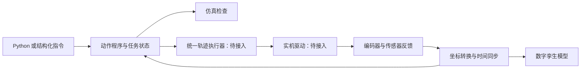

# 动作程序与数字孪生接入

更新：2026-10-06。当前交付为**可编程的 MuJoCo 物理仿真**；设备号 `20250907852512190405` 对应实机尚未连接，未验证电机方向、零位、限位或控制参数。

## 现在可以做什么

网页 http://127.0.0.1:8765/ 新增 JSON 动作程序编辑器、任务状态、暂停、继续、取消。Python 可组合、循环生成动作步骤并提交同一接口。动作按照实际关节反馈到位后推进；闭合夹爪可要求两指与物体同时接触；可在中途检查物体是否已抬起、最终是否放到目标位置。

运行中的程序独占控制权，手动移动和另一个程序都会被拒绝。暂停/取消保持当前臂姿态和夹爪目标；它们是仿真控制操作，不等同于实机急停。任务日志区分目标角和实际角。正常退出使未完成程序失败；进程意外终止后，下一次启动将遗留任务标记失败，不自动续跑。

## 启动与运行

终端一（服务未启动时运行；已打开网页并有画面时不必重复启动）：

```bash
cd '/home/bonvoyage/Desktop/seeed Robotics'
MUJOCO_GL=egl PYOPENGL_PLATFORM=egl ~/.local/bin/rebot-sim serve
```

终端二，运行 Python 编排示例。它显式重置仿真场景，将方块搬走，再抓回原位，共 26 步，约 50 秒仿真时间，实际耗时取决于渲染速度：

```bash
cd '/home/bonvoyage/Desktop/seeed Robotics'
~/.local/share/robotics/envs/rebot-sim/bin/python programs/pick_and_return.py
```

也可在网页先点击“恢复初始姿态”，然后提交单次搬运 JSON：

```bash
python3 scripts/rebot_client.py programs/pick_place.json --wait --timeout 180
```

`rebot_client.py` 只使用 Python 标准库；生成抓取路径的 Python 示例使用现有 `rebot-sim` 环境。接口绑定本机回环地址，不对局域网开放。客户端等待超时不会自行取消服务端任务，需要查询任务或显式取消。

## 编排格式

顶层格式：`{"version": 1, "name": "程序名", "steps": [...]}`。程序在执行前整体校验；未知操作/字段、非有限值、超限目标和找不到逆解的步骤会拒绝整个提交。最多 200 步，单步声明时长 0.1–60 秒。较大位移会自动延长时长，使平滑关节指令峰值速度不超过 0.7 rad/s。

| 操作 | 必填字段 | 含义 |
| --- | --- | --- |
| `move_joints` | `q_deg`: 六个角度 | 官方控制 URDF 坐标，单位度 |
| `move_tcp` | `xyz`: 三个坐标 | `gripper_end` 帧位置，单位米；`orientation` 为 `keep` 或 `down` |
| `gripper` | `finger_m` | 单指模型行程 0–0.05 米；`completion` 为 `position` 或 `contact` |
| `wait` | `seconds` | 保持上一步目标，按仿真时间等待 |
| `assert_object` | `object: "block"`, `xyz`, `tolerance_m` | 对当前物体中心位置做欧氏距离检查，失败即停止 |

各步骤可加 `name`，运动/夹爪步骤可加 `seconds`。`move_tcp` 是求末端逆解后执行关节插值，**没有承诺末端走直线，也没有自动绕障**。姿态 `down` 和抓取偏移仅针对当前模型及 40 mm 方块。

```python
from rebot_client import RebotClient

client = RebotClient()
job = client.submit({
    "version": 1,
    "name": "保持后开爪",
    "steps": [
        {"op": "wait", "seconds": 1},
        {"op": "gripper", "finger_m": 0.032,
         "completion": "position", "seconds": 2},
    ],
})
result = client.wait(job["id"])
```

完整往返示例在 `programs/pick_and_return.py`，通过 Python 循环组合 `pick_place_steps(source, destination)`。source/destination 是**方块中心**，不是末端坐标。重新执行同一抓取程序前应复位方块，或按当前位置生成新程序；不会偷偷重置方块以伪造抓取成功。

## 完成判据与证据

移动步骤在时间结束后还需满足：关节误差小于 0.02 rad、关节速度小于 0.12 rad/s，连续保持 0.1 秒。夹爪位置条件误差小于 2 mm，接触条件则要求两指都接触 block；等待额外 3 秒仍不满足会失败。运行中监测求解警告和非预期接触；两指与 block 的抓取接触被允许。此接触监测是仿真发生接触后的检查，不是完整的预防碰撞规划。

- `outputs/program_verification.json`：26 步往返成功，末端放置后方块回位误差约 0.70 mm；13 步暂停继续成功；取消、错误物体位置、空抓、冻结反馈均按预期结束，4 类无效程序在执行前拒绝。
- `outputs/program_http_verification.json`：HTTP 控制权互斥、暂停继续、取消、历史查询、无效程序拒绝、服务中断任务恢复。
- `outputs/jobs/<任务 ID>.json`：实际网页/Python 运行记录，包含程序、逐步结果、约 20 Hz 的目标/实际关节角、指位移与物体坐标。
- `outputs/program-tests/`：离线物理测试记录。

物理仿真是 40 mm、30 g 方块和每指 20 N 上限的既定场景；没有绑定物体或在运动中改写物体位置。臂仍使用理想偏置力补偿，补偿力在执行器外施加，因此结果**不能作为电机总力矩、额定负载或实机稳定性的验证**。验证次数有限，不表示任意物体、任意位置都已通过。

## ROS 2 相机修复

`rebotarm_mujoco_rs/scene_camera.py` 在 MuJoCo 导入前选择 EGL；launch 新增 `camera_gl:=egl` 默认参数，仅作用于相机进程，交互式 viewer 可继续使用桌面后端。渲染初始化异常后停用该相机定时器，避免每帧重复初始化导致进程崩溃。补丁保存于 `patches/ros-camera-egl.patch`，本地已重新构建相应包。

验收不是仅检查进程存在：`tests/verify_ros_camera.py` 在没有 DISPLAY 的条件下通过 ROS 订阅收到 320×240 RGB 图像及同时间戳相机内参；修改场景物体状态后，图像发生变化。结果为 `outputs/ros_camera_verification.json`，图像为 `outputs/ros_camera_verified.ppm`。

```bash
cd '/home/bonvoyage/Desktop/seeed Robotics'
source /opt/ros/jazzy/setup.bash
source external/reBotArmController_ROS2/install/setup.bash
export PYTHONPATH="$HOME/.local/share/robotics/py312${PYTHONPATH:+:$PYTHONPATH}"
export ROS_HOME="$PWD/.ros"
export ROS_LOG_DIR="$PWD/.ros/log"
ROS_DOMAIN_ID=43 python3 tests/verify_ros_camera.py
```

**模型来源边界：**网页动作执行使用 Menagerie + 控制 URDF 这一组已验证资产；下节新增的 ROS 关节状态和 TF 直接来自同一网页物理实例。此前修复的 ROS 相机仍使用已有工作区的三色物体场景，是独立的相机验证场景。ROS 的 `scene_detector` 读取模拟器物体真值，不是图像识别。本次没有宣称 ROS/MoveIt 完整抓取执行或实机数字孪生已经验收。

## 同一仿真源的 ROS 2 / TF 接口

新增 `scripts/rebot_ros_bridge.py` 与 `scripts/same_sim_ros.launch.py`：桥接只读网页服务的真实物理反馈，不新建第二个物理仿真，不订阅运动命令，也不打开电机总线。TF 使用同一官方控制 URDF，保留源资产不修改，启动时将网格资源路径转换为绝对路径。

在网页服务已启动后，另开终端：

```bash
cd '/home/bonvoyage/Desktop/seeed Robotics'
source /opt/ros/jazzy/setup.bash
export ROS_HOME="$PWD/.ros"
export ROS_LOG_DIR="$PWD/.ros/log"
export ROS_DOMAIN_ID=42
ros2 launch "$PWD/scripts/same_sim_ros.launch.py"
```

| ROS 话题/帧 | 内容 |
| --- | --- |
| `/rebot/sim/joint_states` | 实际测得的六轴弧度 + 两指米制位移，名称与控制 URDF 一致 |
| `/rebot/sim/target_joint_states` | 与实际反馈同一采样时间的目标值，独立话题 |
| `/rebot/sim/status` | JSON 连接状态、反馈年龄、实例 ID、采样序号、跟踪误差、程序状态；明确标注模拟来源 |
| `/rebot/sim/robot_description` | 匹配的 URDF，供 RViz 等显示 |
| `/tf`、`/tf_static` | 帧前缀 `rebot_sim/`；底座 `rebot_sim/base_link`、末端 `rebot_sim/gripper_end` |

桥接读取频率 25 Hz，跟随实际可用采样率。每条消息保留物理采样时刻的时间戳；重复样本不换新时间戳发布。生产者时间戳过期超过 0.5 秒、服务断线或报错时停止发布关节状态，并在 status 标记失联；重新连接后恢复。TF 旧值可能仍被下游缓存，下游必须同时检查 status 与时间戳，不能只凭缓存模型判断实时在线。

`outputs/ros_bridge_verification.json` 已验证：真实运动时收到两路关节消息、实际值与目标值有跟踪差异、ROS 实际值与 HTTP 同源、TF 末端与网页运动学位置一致、过期样本拒绝、断线被报告。单位、符号和坐标这里只验证了仿真链路，不能直接套用到未标定的电机。

复验：

```bash
source /opt/ros/jazzy/setup.bash
ROS_DOMAIN_ID=44 ROS_HOME="$PWD/.ros" ROS_LOG_DIR="$PWD/.ros/log" python3 tests/verify_ros_bridge.py
```

测试会在网页场景空闲时复位机械臂并执行小幅往返动作。当前桥接只提供反馈到 ROS 的方向；标准 ROS 动作控制适配、真实机器人接口、实机驱动模型的闭环还未实现。

## 接实机的下一阶段

当前可复用的是动作程序格式、Python 客户端、任务状态和“目标/反馈分离”的记录约定。底层执行器目前仍直接面向 MuJoCo，实机适配器尚未实现。建议按以下顺序推进：

1. **只读状态接入与标定。** 获取七个电机轴编号与实际型号、总线接口、编码器位置；核对零位、正方向、限位、夹爪行程与 TCP。当前六轴 URDF/Menagerie 的反号映射不能直接当作实机映射。固定模型版本并核对 ROS 模型与当前模型的差异。
2. **由实机反馈驱动显示。** 按时间戳发布实机关节状态，转换到统一坐标后更新模型；断连、过期反馈明确显示，模型不继续假装实际机器人在运动。此阶段先不下发运动命令。
3. **统一轨迹执行接口。** 将目前程序编排接到一个运动执行器；先仿真检查，再由实机适配器下发连续轨迹。完成判定使用实机反馈、误差阈值、超时及驱动器状态，不以“发送成功”代替“动作完成”。保留单一控制写入者。
4. **小幅低速联调再完整任务。** 验证停止、反馈丢失处理和误差监测后，再运行同一份抓取/搬运程序。物体状态断言要替换为经过标定的视觉/传感器结果。

期望结构：



最终屏幕可同时显示“计划目标”和“实机反馈模型”，二者有误差时能看出来。当前支持结构化 JSON/Python 指令；自然语言到动作程序的转换尚未实现，也不直接把自然语言作为电机指令。
