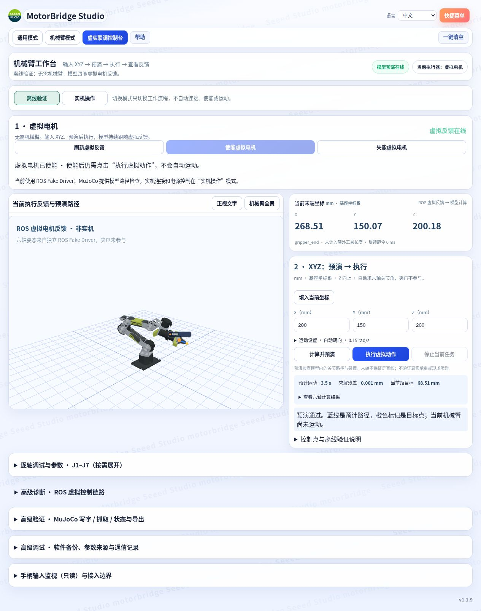
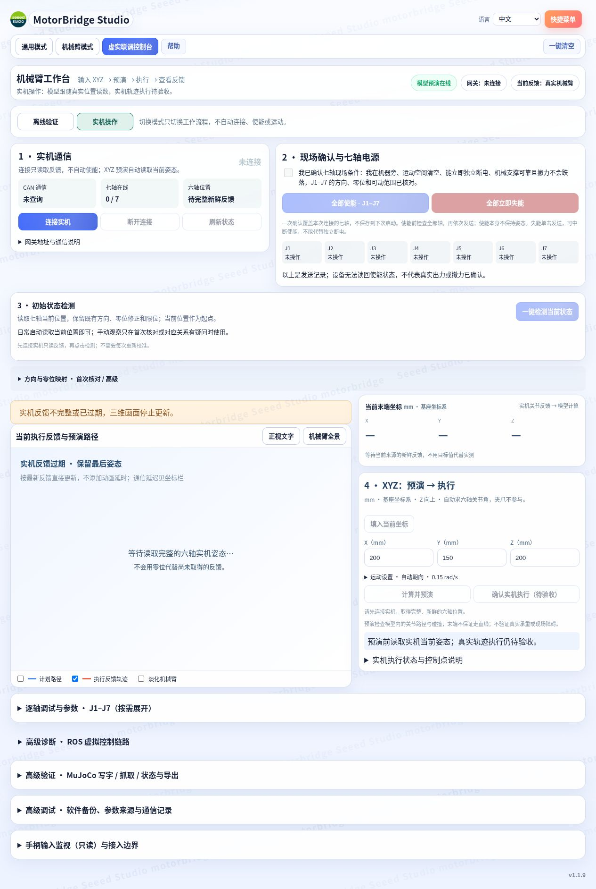

# B601-RS 项目使用手册

更新：2026-10-14。适用于 `codex/mit-console-protection` 分支的当前网页。

本机项目目录是 `/home/bonvoyage/Desktop/seeed_Robotics`，已有环境可以直接启动，不需要重新下载或安装。机械臂暂时不能接入时，先完成下文的离线实验；这些实验不需要 USB-CAN 或机械臂电源。

## 1. 开启项目

本机终端运行：

```bash
cd /home/bonvoyage/Desktop/seeed_Robotics
python3 scripts/start_project.py
```

启动器补齐缺少的服务、复用正常服务，然后打开网页。它不自动使能、不自动执行或续跑动作；复用服务时也不会重置已有任务或虚拟使能状态。

| 服务 | 地址 | 用途 |
| --- | --- | --- |
| 网页与 MuJoCo | `127.0.0.1:8765` | 控制台、模型、IK/路径预演、物理仿真程序 |
| ROS 虚拟电机 | `127.0.0.1:8767` | 隔离的 Fake Driver 和轨迹执行，domain 43 |
| 实机网关 | `127.0.0.1:9002` | 仅监听，等页面明确连接；离线实验不用它 |

打开 [控制台](http://127.0.0.1:8765/zh/studio/console)。`/studio/console` 也是有效入口。原工作台保留在 [网页根目录](http://127.0.0.1:8765/)。

出现“未发现 can0；仿真仍可使用”时，可以继续离线实验。不接实机时不要使用 `--can-up`，也不用点击“连接实机”。如果只想手动启动离线两项服务，可使用两个终端：

```bash
# 终端一：已有 ROS 服务时不要重复启动；这个命令在前台运行
bash scripts/start_ros_validation.sh

# 终端二：只补齐网页与 MuJoCo，ROS 使用终端一的服务
python3 scripts/start_project.py --sim-only
```

常用检查：

```bash
python3 scripts/start_project.py --status   # 仅读状态，不启动或修改 CAN
python3 scripts/start_project.py --no-browser  # 启动但不自动打开浏览器
```

`--status` 检查默认三项服务，网关没有运行时可能返回非零；如果 8765、8767 正常，离线 XYZ 仍可使用。启动日志见 `outputs/dashboard.log`、`outputs/startup/ros.log`；网关日志为 `outputs/gateway.log`。

## 2. 看懂网页的两个模式

| 模式 | 使用流程 | 画面姿态来源 |
| --- | --- | --- |
| **离线验证** | XYZ → 预演 → 执行虚拟电机 → 查看反馈 | ROS Fake 六轴位置反馈 |
| **实机操作** | 读取实机 → 初始状态检测 → 从当前位置预演 → 经实机验收后执行 | 真实关节位置读数 |

默认是离线验证。切模式不连接、使能或移动电机；任务运行期间不能切换。

蓝色“计划路径”是预演得到的模型路径；橙色“执行反馈轨迹”来自当前执行器的反馈。预演检查模型中的 IK、关节范围和碰撞，不是完整承重验证，也不知道现场未建模的障碍。当前位置显示的是反馈关节角经模型计算的末端坐标。

离线主界面示例：



## 3. 实验一：不接实机，让虚拟电机到达 XYZ

1. 选择 **离线验证**，等待“虚拟反馈在线”。
2. 点击 **使能虚拟电机**。只使能 Fake Driver；已经使能时按钮灰显是正常状态。
3. 输入 `X=200、Y=150、Z=200`。单位是 **毫米**，相对机械臂基座坐标系，Z 向上。这个点已做离线验证，但任意输入的点不一定可达。
4. 保持“自动朝向”，点击 **计算并预演**。无需手动同步或逐轴填角度。
5. 查看目标关节角、预计时间、求解残差和蓝色计划路径。此时虚拟电机还没有移动。
6. 预演成功后，点击 **执行虚拟动作**。三维模型和当前 XYZ 会持续跟随虚拟反馈，橙色轨迹随动作生成。
7. 等待“执行完成”，将当前坐标与输入坐标比较。理想 Fake 的误差不能当成真实机械臂精度。

也可以先点 **填入当前坐标**，再把一个坐标小幅改动，例如 Z 减少 5 mm，重新预演；如果不通过，按页面具体原因处理，不必填写高级电机参数。

“运动设置”内可选择朝向和规划速度；主界面默认 0.15 rad/s，这是关节规划速度，不是末端 mm/s。目标的关节路径通常不是笛卡尔直线。夹爪 J7 不参与六轴 XYZ 求解；控制点是 `gripper_end`，尚未计入额外打印头/工具长度。

预演有效期为 60 秒，令牌只能使用一次。起点变化、超时、配置版本变化或切模式后，要重新预演；不能把实机预演交给虚拟执行器运行。

## 4. 实验二：中途停止虚拟动作

1. 先按实验一完成一次到点，再输入另一个可达点并预演，选择有足够运动时间的动作。
2. 点击 **执行虚拟动作**，移动过程中点击 **停止当前任务**。
3. 查看任务进入取消状态，后续位置和轨迹不再继续原任务；等待取消结束后可重新预演。
4. **失能虚拟电机**也只作用于 Fake Driver。当前适配器不会用失能自动回零。

关闭浏览器或启动终端不会代替停止任务；后台服务仍可能继续运行。此实验验证软件取消链路，不证明真实电机的物理停止距离。

## 5. 实验三：一笔立体书写“国庆快乐”

这个既有程序在 **MuJoCo 物理仿真**中执行，与主流程的 ROS 虚拟 XYZ 分开。无需实机，也不需要先使能 ROS 虚拟电机。

1. 先结束当前 ROS 虚拟任务，保持 **离线验证**。
2. 展开 **高级验证 · MuJoCo 写字 / 抓取 / 状态与导出**。
3. 在“任务执行”的下拉菜单选择 **国庆快乐 · 连续立体书写**。
4. 点击 **重置并开始执行**。它只重置该物理仿真场景，再执行摆姿、接近、连续书写和移开等阶段。
5. 模型自动切到 MuJoCo 任务反馈，并显示“正在查看高级 MuJoCo 任务”的提示。用 **正视文字**、**机械臂全景**调整观察方向；可勾选“淡化机械臂”。
6. 使用该高级区的 **暂停 / 继续 / 取消任务**；完成后可点击 **导出轨迹与执行记录**。
7. 点击模型上方 **返回当前执行反馈**，回到 ROS 虚拟主流程。这个操作不会把两个执行器的姿态复制给彼此。

文字采用中心线、回描和空间连接段组成一条连续路径，位于倾斜平面；虚拟打印点是 `gripper_end`。亮线来自实际仿真末端反馈。它不模拟材料沉积、冷却或悬空成型，不是实体切片打印。

完整程序在 [national_day_one_stroke.json](../programs/national_day_one_stroke.json)；细节见 [一笔三维轨迹说明](国庆快乐_一笔三维轨迹.md)。暂停期间不要重新开始另一项任务；取消/重置会影响本次轨迹记录。

## 6. 实验四：抓取、搬运、放置并抓回

1. 等待/取消当前虚拟或 MuJoCo 任务。
2. 在同一个 **高级验证 · MuJoCo 写字 / 抓取 / 状态与导出**区域，选择 **抓取并放置 · 往返搬运**。
3. 点击 **重置并开始执行**。程序按接近、闭合夹爪、抬升、搬运、放置、抓回等步骤执行，并检查仿真反馈。
4. 使用 **机械臂全景**观察关节和夹爪姿态；在高级区查看当前步骤、完成步骤数、错误提示。控制台 URDF 视图不呈现完整物体接触场景，需观察搬运物体时可打开 [原 MuJoCo 工作台](http://127.0.0.1:8765/)，不要在两个页面同时启动任务。
5. 可暂停、继续、取消；完成后导出记录，再 **返回当前执行反馈**。

可编辑程序参考 [pick_place.json](../programs/pick_place.json) 和 [pick_and_return.py](../programs/pick_and_return.py)。这里验证的是 MuJoCo 场景中的接触与任务反馈，不是实际物体抓取力或 J7 实机标定。

## 7. 初始状态检测和实机功能的边界

**2026-10-15 当前状态**：原网页已完成两次六轴原生 CSP 邻近 XYZ 到位，随后 J6 和 J7 分别完成独立 +0.5° 小幅到位；各次结束均核对失能、持续停稳及临时参数恢复，用户确认安静、无异常。这不代表完整工作空间、长期保持、连续书写或夹爪开口/夹持力已标定。

自己调试邻近 XYZ 时：**实机操作 → 连接实机 → 一键检测当前状态 → 填入当前坐标 → 修改邻近目标 → 计算并预演 → 查看六轴计算结果 → 当次现场确认 → 确认实机执行**。默认采用已实测的 **原生位置闭环（CSP）· 小幅 XYZ 试验**。不提前点击“全部使能”，执行器会先读取并装载当前位置，再按本次任务使能；到位后自动失能，不长期保持。观察到位记录时应使用“撤力前”反馈，撤力后的坐标可能变化。

当前仅允许每轴变化≤0.5°、速度≤0.02 rad/s、首次使能起最多15秒。先从当前坐标附近约1 mm的目标开始，能否执行以预演的每轴变化、模型路径及新鲜反馈为准；XYZ距离小不保证关节变化小。超出范围需另行验证，不能用拆分目标或提高参数绕过。J7不参与XYZ求解，其+0.5°指电机角而非夹爪开口距离。

恢复连接后，在 **实机操作**模式：

1. 点击 **连接实机**，仅查询反馈；网关连接成功不等于七轴都在线。
2. 点击 **一键检测当前状态**。它读取七轴位置和模式，按既有方向、零位映射核对六轴模型起点，并保留原始角度。结果是带时间的检测快照。
3. 日常启动读取当前姿态即可。断电支撑下的稳定姿态是起点，不应写成机械零位；已约定的六轴 1° 起点偏差不会扩大目标限位。
4. 首次对应关系有疑问时，可以展开“手动变化观察”。确认真实撤力和支撑后，从点击时当前角度开始记录小幅变化，对确实观察到的轴做一次整体视觉确认。承重轴可以跳过，不需要手托或大幅来回晃动。
5. 手动变化记录不能自动确定真实正方向、机械零位或完整可动范围，也不自动改映射。断连、反馈过期、电源操作或映射变化会中断/撤销当前确认。

实机模式入口示例（截图未连接设备）：



| 功能 | 当前实际能力 |
| --- | --- |
| 七轴读数、六轴模型/XYZ | 按新鲜真实关节读数更新；过期停止更新，不拿目标代替实测 |
| 七轴统一现场确认 | 一个确认框；只用于本次连接，不保存到下次启动 |
| 全部使能 · J1–J7 | 全轴预检后依次发送，不发送 MIT 保持或运动目标；不代表已经能承重 |
| 全部立即失能 | 单击排入七轴失能，可中断未完成的使能/检测；不能替代现场独立断电 |
| XYZ 预演 | 从当前实机读数检查模型路径，不发送真实目标；模型同步另有严格范围/碰撞检查，容差检测通过不保证该同步也通过 |
| 确认实机执行 | Seeed SDK/原生CSP已完成两次邻近XYZ到位；预演、执行预检、新鲜反馈及当次现场确认通过后可提交范围内的新任务 |
| 手柄 | 只读输入监视，尚不能操控真实机械臂 |

网页电源记录只是请求结果，不代表真实出力或撤力。原生CSP任务另保存到位反馈、失能SDK状态、持续停稳和参数恢复记录；不能把离线通过、检测通过或使能请求成功当作物理到位证明。模型直接跟随真实反馈，但通信延迟和速度同步效果仍需测量。实测原始记录见[当天报告](validation/official-mit-2026-10-15/report.md)。

### 历史试验记录（当前能力以上述2026-10-15状态为准）

2026-10-14 经用户明确授权，已从独立终端入口向 J1 真实发送 +0.5° 试验轨迹，采用 3/1/0。反馈没有到位，5 秒超时后发送 J1 失能；用户确认结束后已安静。此次不算运动验收通过，不开放网页 XYZ，也不自动重复或提高增益。详见 [现场记录](validation/j1-2026-10-14/report.json)。终端入口的动作不会出现在网页“本会话”电源请求记录中。

后续版本已接入网页 XYZ 执行入口，上述“不开放”是 J1 试验当时的状态。在 **运动设置**中可选 **Seeed 官方：Kp=3 / Kd=1 + 重力前馈**，复用官方普通 MIT 轨迹回调，按新鲜六轴姿态计算前馈；它是本次任务选择，不覆盖已保存草稿和设备参数。先预演并查看拒绝原因/预计用时，再按现场试验流程执行；首帧保持实测当前位置，不自动回零。原“前馈=0”方案保留为历史选项，当前默认使用原生CSP。

模型预检查通过不能证明真实承重。最新真实任务曾因 J2 实测速度超界停止，未到位，不自动重试；完整记录与风险见 [XYZ 执行和官方前馈验证](validation/xyz-console-2026-10-14.md)。已使能仍无保持力并不代表程序未连接：单独使能按钮不发送 MIT 保持目标。

2026-10-15 新增 **试验：官方范围增益 + 重力缓启动**。当前任务增益为 Kp 80/75/150/50/40/40、Kd 5/6/10/5/4/4，使能后立即安装新鲜位置保持，重力力矩在 8 秒中建立；不覆盖上述 3/1/0 草稿。渐变力矩是本项目对官方函数的适配，不是官方默认或本机已调参数。网页真实试验在 J3 偏离起点 0.645° 时停止，六轴失能有回执，随后反馈稳定；**XYZ 轨迹尚未开始，到位尚未完成**。用户已观察确认 J1 不受支撑限制、连杆和夹爪不接触桌面/支撑物；不能据此推断实际质量、重力方向或零位映射已独立验证。当前不应重复相同失败方案，下一步核对安装方向与本机保持力矩。报告保存目标、起点和逐帧主机请求；最新代码也保留部分发送及异常发送记录，软件回执不是逐帧驱动器确认。详见 [实机记录与剩余条件](validation/official-mit-2026-10-15/report.md)。

2026-10-15 后续：用户明确批准延长同一 J3 原生 CSP +0.5° 试验至最多 15 秒。实测移动约 0.425°，目标 0.815°、到位反馈 0.745°，误差 0.070°；约 8.675 秒后自动撤力，四项临时运行参数恢复并读回核对。PID、零位和保存草稿不变。这是单轴反馈到位，六轴 XYZ 尚未验收，见 [15 秒实测](validation/official-mit-2026-10-15/native-csp-15s-analysis.json)。

六轴软件入口已接回现有 XYZ 面板：**运动设置 → 轨迹控制方案 → 原生位置闭环（CSP）· 小幅 XYZ 试验**。点击“填入当前坐标”，定义一个邻近目标，再“计算并预演”；“查看六轴计算结果”显示每轴目标和变化量。此试验固定每轴≤0.5°、0.02 rad/s、首次使能起最多 15 秒，使用驱动器已有 PID，临时降低电流/力矩限制；结束后失能并核对恢复，不回零、不写掉电保存，J7 不参与。新目标须重新预演，不提前点“全部使能”。目前仅完成虚拟 SDK 和模型检查，六轴临时参数及实发须对具体方案单独确认，不能把 J3 的批准直接扩大到六轴。

**2026-10-15 11:47 更新**：用户批准一次六轴 CSP 后，已通过本页面将真实机械臂移动到 `[300.51,13.09,227.03]` mm 的邻近目标。约4.91秒请求停止，到位时六轴最大关节误差0.088°、模型TCP误差0.512 mm；随后六轴失能、稳定反馈和临时参数恢复确认，用户观察“已安静，无异常”。因此上文“六轴仅软件验证”为历史状态。详见[真实到点报告](validation/official-mit-2026-10-15/native-xyz-arrived-analysis.json)。控制台的模型跟随实际反馈，到位后自动撤力，释放后的坐标可能变化，不把释放后读数当作到位时误差。本次只验证小幅邻近点；J6保持原角度，夹爪没有参与，完整工作空间和连续书写尚待验收，不自动重复本次许可。

## 8. 参数、记录和保存

“逐轴调试与参数 · J1–J7”默认折叠，做上述离线实验不用填满高级参数。Kp、Kd、前馈力矩是 MIT 每帧控制值；当前用户指定的草稿为 **3 / 1 / 0**，不是官方通用默认值、设备读回或已验收承重参数。软件速度/加速度/jerk 边界与设备内部参数也不是同一类值。

“高级调试 · 软件备份、参数来源与通信记录”支持软件草稿备份。真实设备局部只读快照、人工批准软件配置、MIT 每帧参数各自有来源状态；软件备份不能冒充完整实机参数备份。

| 内容 | 位置 | 是否随 GitHub 更新 |
| --- | --- | --- |
| 网页完整源码 | `external/motorbridge-studio/src` | 是 |
| 程序、模型和第三方锁定版本清单 | `programs`、`models`、`configs` | 是；第三方大仓库按清单重建 |
| 私有草稿/批准记录/局部设备快照 | `outputs/private_config` | 否，另行导出与保管 |
| 本机日志、PID、运行任务记录 | `outputs` 下对应目录 | 不作为部署配置上传 |
| 筛选后的软件验收报告 | `docs/validation` | 是，标明离线与真实验收区别 |

初始检测区可导出 JSON；MuJoCo 高级区可导出轨迹。导出含反馈和来源，分享前注意其中是否有现场数据。

## 9. 常见情况

| 现象 | 处理 |
| --- | --- |
| 网页打不开 | 运行 `--status`，检查 8765 与 `outputs/dashboard.log`。 |
| ROS 虚拟反馈离线 | 检查 8767、`outputs/startup/ros.log`；单独启动 ROS 的终端应保持运行。 |
| 界面还是旧版本 | 先强制刷新；源码有变化但 dist 未构建时，按下一节构建。 |
| 执行虚拟动作灰显 | 等待新鲜反馈、使能虚拟电机并成功预演；过期或起点改变要重算。 |
| 实机检测按钮灰显 | 施工期间未连接是正常情况，继续使用离线模式。 |
| 实机执行按钮灰显 | 查看预演拒绝原因；需新鲜反馈、有效预演、当次现场确认且没有活动任务。修改坐标/设置后须重新预演。 |
| 前馈=0 无法平衡重力 | 可显式选本次任务的 Seeed 官方重力前馈后重新预演；保存参数不变，模型通过仍须真实原位保持验收。 |
| J2 实测速度超界 | 任务已停止；核对启动阶段反馈、支撑与所选方案，不自动提高边界或重试。 |
| “已有任务”或无法重置 | 等待该任务结束，或在所属执行器区取消；ROS 停止和 MuJoCo 取消是不同入口。 |
| IK 残差大、关节越界或碰撞 | 输入可能不可达；核对 mm、坐标系和朝向，用自动朝向，尝试当前点附近的小幅修改。 |
| 高级任务结束后模型与 ROS 起点不同 | 两个执行器独立；点“返回当前执行反馈”，不用把 MuJoCo 结束姿态强制同步到 ROS。 |

只改前端源码后，本机执行：

```bash
cd /home/bonvoyage/Desktop/seeed_Robotics/external/motorbridge-studio
VITE_BASE_PATH=/studio/ /usr/lib/chatgpt/resources/cua_node/bin/node node_modules/vite/bin/vite.js build
```

有普通 Node/npm 的电脑使用 `VITE_BASE_PATH=/studio/ npm run build`。改后端后，先结束虚拟任务，再运行 `bash scripts/restart_sim.sh --host 127.0.0.1`；启动器复用旧进程，不会替旧进程加载新代码。退出服务前先停止所属任务并核对进程身份；不要把关网页当作电机失能。

## 10. 在另一台电脑部署

本版本以 Ubuntu/Kubuntu 24.04、Python 3.12、Node 22.12+ 与 npm、ROS 2 Jazzy 和可用 EGL/OpenGL 为部署目标。网页是本仓库完整源码；GitHub Pages 单独托管前端不能运行本地 Python/ROS 后端。Windows/macOS 的原生完整部署尚未验收。

安装系统依赖、Node/npm 和 ROS Jazzy 后，使用当前开发分支：

```bash
git clone --branch codex/mit-console-protection https://github.com/On-aroll/rebot-arm-b601.git
cd rebot-arm-b601
python3 scripts/setup_external.py

python3 -m venv .venv-sim
.venv-sim/bin/python -m pip install -r configs/requirements-lock.txt

cd external/motorbridge-studio
npm ci
VITE_BASE_PATH=/studio/ npm run build
cd ../..
```

这时可以单独开启 MuJoCo 网页：

```bash
REBOT_PYTHON="$PWD/.venv-sim/bin/python" python3 scripts/start_project.py --sim-only
```

MuJoCo 写字/抓取已可按第 5、6 节运行；完整离线 XYZ 主流程还需要构建并启动 ROS Fake：

```bash
bash scripts/build_ros_validation.sh
bash scripts/start_ros_validation.sh
```

ROS 构建要求系统 ROS Jazzy 环境中有 colcon、`control_msgs`、`tf_transformations` 等依赖，系统 Python 可导入 NumPy；详见上游 `rebotarmcontroller/package.xml`。系统 ROS 依赖与 `.venv-sim` 的 Python 依赖分别安装，不要将 ROS 构建环境混到任意 Python 虚拟环境。第三方版本由 `configs/external-manifest.json` 锁定；只运行本项目的 Fake 启动脚本，不直接启动上游真实控制节点。

新电脑若还需启动网关及真实任务工作进程，另外创建硬件环境（离线双服务不需要）：

```bash
python3 -m venv .venv
.venv/bin/python -m pip install -r configs/requirements-hardware.txt
```

该清单锁定 motorbridge 0.5.6、Pinocchio 和 PyYAML；硬件工作进程使用同一 `.venv/bin/python`，不要将系统 Python 和其他环境的扩展库混用。私有配置不随克隆迁移；不要自动填默认值代替原机器的已调参数。已有环境正常时，日常启动只用第 1 节，不重复安装。

## 11. 施工期间适合继续做的工作

可以反复验证可达点、起点变化拒绝、预演过期、取消/重做；调整文字几何和仿真程序；记录操作体验与错误提示；检查仿真夹爪/物体任务。物理方向零位、真实承重与停止距离、夹爪开合标定和真实通信延迟留待施工结束后现场验证，离线结果不代替这些项目。

开发者复验命令及本次软件报告见 [软件交付验收](validation/console-2026-10-14/README.md)。日常重启与日志排障见 [项目重启指南](项目重启指南.md)。


2026-10-15 启动诊断补充：实机模式选择“试验：官方范围增益 + 重力缓启动”、重新预演并完成现场确认后，可展开 **启动诊断（按需）**，点击 **启动采集 · 3 秒自动撤力**。它只观测启动，不执行 XYZ；从首次使能起三秒停止新目标并请求撤力，SDK 阻塞仍可能延迟实际撤力。启动采集不是自动零位校准。J3 电流已测到有效变化，但原始转矩寄存器在出力时仍为零，不将其作为转矩标定。三秒自动结束、六轴失能回执及随后稳定反馈已经实测；完整 XYZ 到位仍未通过。用户确认底座直立固定在水平桌面，暂不改重力方向。长时间闲置页面会在每次明确提交新任务前建立新会话，不自动重发执行请求。
