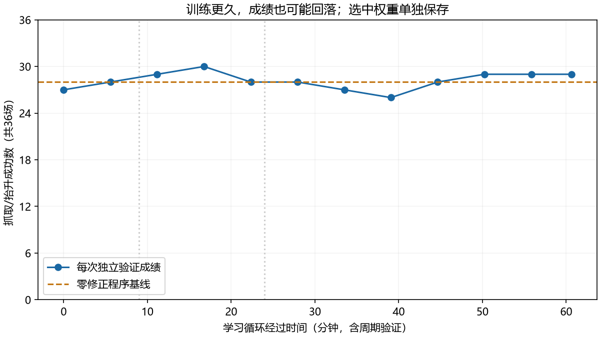

# 一小时残差强化学习 R2：结果与交付

完成147564步交互及三批独立新场景测试。**模型减少了一部分首次抓偏，但没有提高完整任务成功率，不采用为V4；默认仍是冻结V3。** 本轮没有连接机械臂。

## 训练与实际作用

复用MuJoCo、V3感知/IK和[Stable-Baselines3 SAC 2.7.1](https://stable-baselines3.readthedocs.io/en/v2.7.1/modules/sac.html)。从R1演员继续训练，观测由36维扩为39维，增加“视觉目标减自身TCP”的误差。新增输入初始权重为零，128组输入与原演员完全一致；优化器和回放池重新开始。物体真值、接触评分、注入偏差及教师阶段不进入演员。

演员只输出XYZ和夹爪小修正，上限12/12/8/6mm、每步变化2/2/2/1.5mm。增加五步张开对准，再执行原十八步闭合/抬升。观察、规划、运输、放置、验收及重试仍由程序负责，不能称为模型学会整套A/B/C任务。

加入5→20→35mm抓偏课程、接触/相机/命令延迟变化、25%简单任务复习、逐段降低学习率、视觉误差势函数奖励和独立验证选优。物理范围未经实机标定；相机视点变化不等于实际标定误差。四个仿真进程，CPU训练小网络、GPU渲染。

| 实际记录 | 结果 |
|---|---:|
| 训练seed / 验证seed | 1280 / 36，互不重叠 |
| 交互步数 | 147564 |
| 完整抓取练习 | 6528 |
| 夹持抬升成功 / 失败 | 5093 / 1435 |
| 失败细分 | 初始视觉49、复看拒绝71、夹持抬升1315 |
| 简单任务复习 | 1628回合，24.94% |
| 未完成尾段 | 4回合、60步，已保存，不计完整回合 |
| 禁止接触 | 0 |
| 学习循环含周期及最终验证 | 3637.95秒，其中最终验证约38秒 |
| 连同初始验证总耗时 | 3706.67秒，约61.78分钟 |

主机Core Ultra 5 230F、约24GB RAM、RTX5060Ti 8GB。训练中单次采样CPU42%、显存3022MiB、GPU41℃，不是峰值或板端测量。配置、训练统计及实际源码快照全部保留。

## 更久并不总是更好

固定验证：零修正28/36，初始R1为27/36。最佳44724步、约16.77分钟达到30/36（简单/中等/困难为12/12、12/12、6/12），后续最低26/36，最后29/36。采用较早的最佳权重；重新验证仍为30/36。这是选模型用验证，不能当作新场景泛化成绩。

## 新场景完整任务对照

宽范围53000000–53000035，共36场，A/B/C各12，普通/外力/首次正负35mm抓偏各9：V3、零修正、R1演员、新SAC均36/36，首次18、重试后18，没有显示模型收益。平均模拟耗时依次43.162、44.740、44.706、44.626秒。

边界54000000–54000029，共30场，正负27/28/29mm、A/B/C均衡：

| 控制器 | 完整成功 | 首次成功 | 重试后成功 | 成功回合平均模拟耗时 |
|---|---:|---:|---:|---:|
| V3 | 29/30 | 7 | 22 | 48.858秒 |
| 新时序、零修正 | 29/30 | 9 | 20 | 49.161秒 |
| R1演员配新时序 | 29/30 | 11 | 18 | 47.611秒 |
| 一小时SAC选中权重 | 28/30 | 14 | 14 | 44.796秒 |

SAC减少了部分首次失手，但额外失败54000011中，物体从约[0.296,-0.038]移动到[0.269,-0.064]m，下一次视觉置信不足而终止。54000001四种方案均复看失败。不能以少重试掩盖完整成功率下降；表中耗时只统计成功回合，成功子集也不完全相同。

另发现R1包装器在复看被拒绝后直接退出，原V3会返回HOME使用剩余机会。task_r2.py恢复这一流程，仍最多三次尝试；初始无可信目标和IK异常保持原处理。54000001回归由一次提前结束变为三次真实复看拒绝，仍失败，未伪造成成功。旧结果原样保留。

修正后再测57000000–57000029共30个全新场景，权重和限幅不变：

| 控制器 | 完整成功 | 首次成功 | 重试后成功 | 全部回合平均模拟耗时 |
|---|---:|---:|---:|---:|
| V3 | 29/30 | 6 | 23 | 49.506秒 |
| 修正后零残差 | 29/30 | 9 | 20 | 49.285秒 |
| 修正后SAC | 29/30 | 14 | 15 | 45.463秒 |

完整成功率未提高，共同有一个失败。两批seed不同，不能将28→29解释为同场修复提升。收益有方向取舍：SAC正向首次4/15对零修正8/15，反向10/15对1/15；尚无固定偏置消融，不能宣称普遍视觉纠偏能力。恢复程序的修复也不算模型学习成果。

合计96个新场景、354次完整任务，均不参与重新选模型。三批独立重算177000条最终物理评分，核对354条双指夹持抬升轨迹、成对初始化、最多两次重试与划分；3243次SAC提议与TorchScript、NumPy和限幅一致。三批均无误报或禁止接触。详见delivery三份SUMMARY及三份AUDIT。

## 推理、成本与回板准备

选中检查点SHA256：462ca7cb4506470f9df98531ecfbf1ff4c8b801a340d2915e777330d7cd73eb0。SAC包363620字节；演员7240参数（含训练用方差头），确定性子网6980参数。TorchScript46015字节，NumPy权重27197字节；3243次实际提议的NumPy最大误差5.33e-7。

主机独立CPU进程各测2000次：TorchScript加限幅中位0.0309ms、P95 0.0532ms、RSS约404MiB；NumPy加限幅中位0.0069ms、P95 0.0077ms、RSS约30.5MiB。仅是残差组件，不含RGB-D、视觉、IK、执行器、功耗和真实板子。完整系统仍有Torch视觉，不能把独立进程内存差当作整套系统已节省内存。

infer_numpy.py可离线提议；run_sim.py支持指定A/B/C并读取仿真画面和自身反馈。A/B/C各一条入口回合成功，仅验证入口，不计正式成绩。复现见README.md，板端影子验证、标定和实机数据回传见REAL_DATA.md。

## 保存与局限

- 保存完成回合、失败、权重/优化器、回放、验证及源码快照。紧凑训练保存初始/复看RGB-D和逐步输入；失败训练及所有验证另存逐决策演员RGB-D，成功训练不保留逐步完整图像。逐决策图像按顺序保存，未逐帧另存相机时间戳，不能冒称实机时钟同步。完整任务使用20Hz动作、5HzRGB-D。
- 147504个完整回合决策加60步尾段等于147564。SB3在停止回调后不再存当次四步，它们仍完整保存在原始记录；其余147560条与回放逐项对账，输入/动作误差0，奖励误差小于1e-6。
- 首个运行在会话更新时中断，保留674回合、15106个已落盘决策和四个不完整目录；最后进度文件仅到12384步。无训练后周期权重或回放，不能恢复那几分钟，也不计入一小时成果。随后独立后台重跑完整一小时，未补造旧尾段。
- 开发3个seed乘6种偏差的18个条件：零修正7/18、相机Y反馈9/18、已知注入方向的限幅探测15/18。最后一种只检验物理可修正性，不是模型或可部署策略；SAC不接收该标签。正负30/40mm仍未被小修正救回。
- 仍为单个红橙立方体、已知桌面，无多物体/障碍和实机验收。下一轮先处理遮挡视觉偏移、两侧取舍和动作包络，补经确认有效的纠正数据；单纯加时没有持续提高最佳成绩。

模型、配置、报告与推理入口随Git备份；完整新增原始记录另按Release增量归档并核验服务端SHA256，以远端核验回执确认完成。V3及旧失败保留，不重复上传旧ACT/R1归档。

本轮归档地址：[一小时SAC R2 Release](https://github.com/On-aroll/rebot-arm-b601/releases/tag/sim-sac-long-2026-10-24)。只有handoff/SIM_SAC_LONG_RELEASE_VERIFIED_2026-10-24.json存在且all_assets_verified为true时，才算全部远端备份完成。
